# Insta360 Wave — Complete Audio Processing Pipeline

**Source:** Ghidra decompilation of `libInstaAudio.so` (1,634 functions), `libTEAProcessSdk.so` (8.5 MB), `libbva_audio.so` (1.9 MB), and embedded JSON config at binary offset `0x375688`.

**SDK:** Roomix TEA SDK v3.10.1.1153 (`dev/tea_process_x2_sdk_v7u_qoroliang.Roomix-dev`)

---

## Table of Contents

1. [High-Level Architecture](#1-high-level-architecture)
2. [Hardware Audio Path](#2-hardware-audio-path)
3. [Software Processing Chains](#3-software-processing-chains)
4. [Pipeline Mode 0: Meeting (Noise Reduction)](#4-pipeline-mode-0-meeting-noise-reduction)
5. [Pipeline Mode 1: Live (Beamforming)](#5-pipeline-mode-1-live-beamforming)
6. [Stage-by-Stage Deep Dive](#6-stage-by-stage-deep-dive)
7. [AGC Chain Analysis](#7-agc-chain-analysis)
8. [ASR Audio Path](#8-asr-audio-path)
9. [Audio Mode Switching](#9-audio-mode-switching)
10. [Dynamic EQ & Reverb Post-Processing](#10-dynamic-eq--reverb-post-processing)
11. [Debug & Dump Infrastructure](#11-debug--dump-infrastructure)
12. [Full Embedded Configuration](#12-full-embedded-configuration)

---

## 1. High-Level Architecture

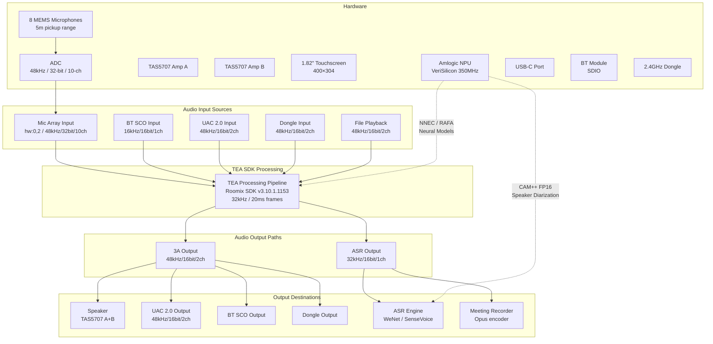

---

## 2. Hardware Audio Path

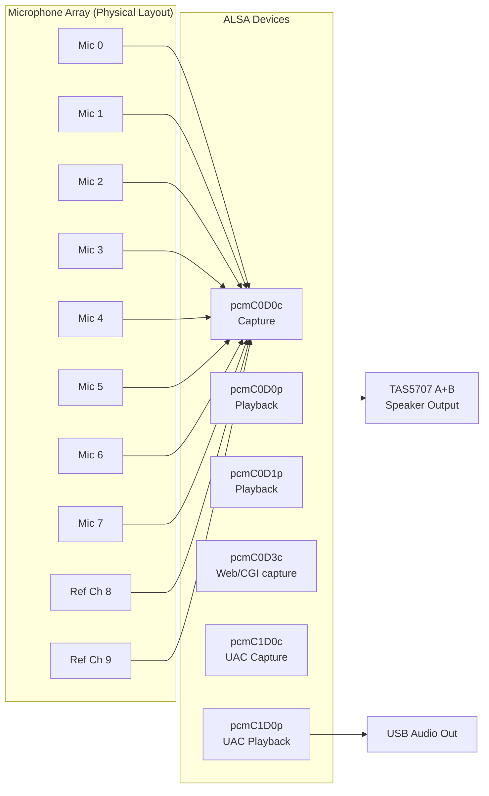

### ALSA Configuration (`/etc/asound.conf`)

| PCM Device | Direction | Sample Rate | Channels | Purpose |
|---|---|---|---|---|
| `hw:0,0` | Capture | 48kHz | 10 | Raw microphone array |
| `hw:0,0` | Playback | 48kHz | 8 | Speaker output (2→8 upmix) |
| `hw:0,1` | Playback | 48kHz | 2 | Default playback |
| `hw:0,2` | Capture | 48kHz | 2 | Processed mic input |
| `hw:0,3` | Capture | 48kHz | varies | CGI/Web recording |
| `hw:0,4` | Capture | 48kHz | 2 | AVS input |
| `hw:1,0,0` | Both | 48kHz | 2 | USB Audio Class 2.0 |

### Channel Mapping

From `/etc/channel_map_config_default.json`, the 10 input channels map to:
- **Channels 0-5**: 6 active microphone signals (used for beamforming)
- **Channel 6-7**: Additional microphones
- **Channel 8-9**: Reference channels (speaker loopback for AEC)

The TEA SDK processes **6 channels** (`process_channel_num: 6`) with `mic_selective_mode: 7`.

### Amplifier Configuration

Two TAS5707 digital amplifier chips:
- Volume range: 0-511 (stored in `/data/system_volume`)
- Default volume: 150/511
- Master volume from `/etc/EXT_AMP.ini`: 230/511
- ALSA control: `snd_ctl_elem_*` on card 1

---

## 3. Software Processing Chains

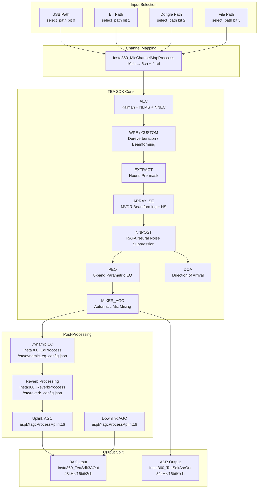

---

## 4. Pipeline Mode 0: Meeting (Noise Reduction)

Active when Audio Mode = "Noise Reduction" (Mode 1 in `setWorkMode()`).

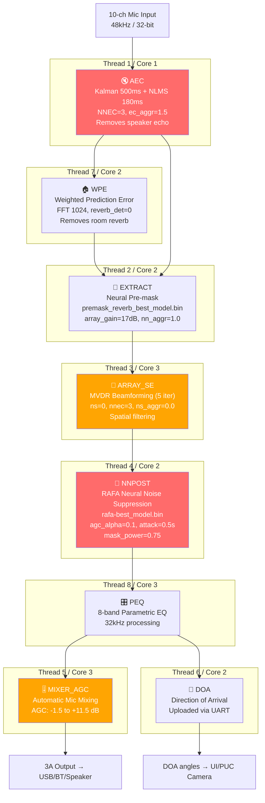

### Meeting Pipeline Parameters

| Stage | Key Parameters | Threading |
|---|---|---|
| **AEC** | `aec=1, kalman=1, nnec=3, ec_aggr=1.5, kalman_len=500ms, nlms_len=180ms` | Thread 1, Core 1 |
| **WPE** | `use_wpe=1, wpe_fft_size=1024, wpe_reverb_det=0` | Thread 7, Core 2 |
| **EXTRACT** | `array_gain=17.0, nn_aggr=1.0, cache_clear_policy=1, model=premask_reverb_best` | Thread 2, Core 2 |
| **ARRAY_SE** | `ns=0, mvdr_switch=1, mvdr_iters=5, nnec=3, ns_aggr=0.0, array_gain=8.0` | Thread 3, Core 3 |
| **NNPOST** | `model=rafa-best, aggr=1.0, mask_power=0.75, agc_apply=1, agc_alpha=0.1, attack=0.5, release=0.5` | Thread 4, Core 2 |
| **PEQ** | `8 filters, 32kHz, dynamic_headroom=0` | Thread 8, Core 3 |
| **MIXER_AGC** | `agc=1, amm=1, max_gain=11.5, min_gain=-1.5` | Thread 5, Core 3 |
| **DOA** | `upload_with_uart=1, upload_with_teasdk=0` | Thread 6, Core 2 |

---

## 5. Pipeline Mode 1: Live (Beamforming)

Active when Audio Mode = "Original" with any beamforming pattern (Modes 2-6 in `setWorkMode()`).

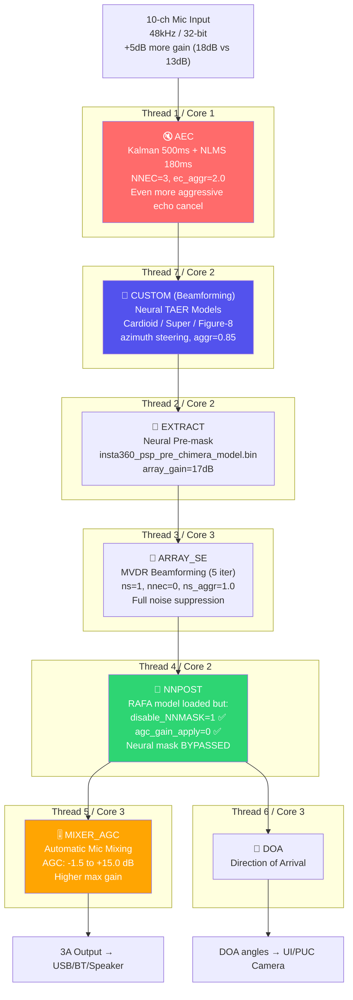

### Live Pipeline Parameters

| Stage | Key Parameters | Difference from Meeting |
|---|---|---|
| **AEC** | `nnec=3, ec_aggr=2.0` | Even more aggressive (2.0 vs 1.5) |
| **CUSTOM** | `az_enable=1, aggr=0.85, 9 neural models` | Replaces WPE; directional beamforming |
| **EXTRACT** | `model=insta360_psp_pre_chimera_model.bin` | Different model (Chimera vs Reverb-premask) |
| **ARRAY_SE** | `ns=1, nnec=0, ns_aggr=1.0` | NS enabled, NNEC disabled |
| **NNPOST** | `disable_NNMASK=1, agc_gain_apply=0` | **Neural mask and AGC bypassed** |
| **MIXER_AGC** | `agc_max_gain=15.0` | Higher max gain (15 vs 11.5 dB) |
| Global | `process_pcm_dB_gain=18.0` | 5 dB more input gain (18 vs 13 dB) |

---

## 6. Stage-by-Stage Deep Dive

### 6.1 AEC (Acoustic Echo Cancellation)

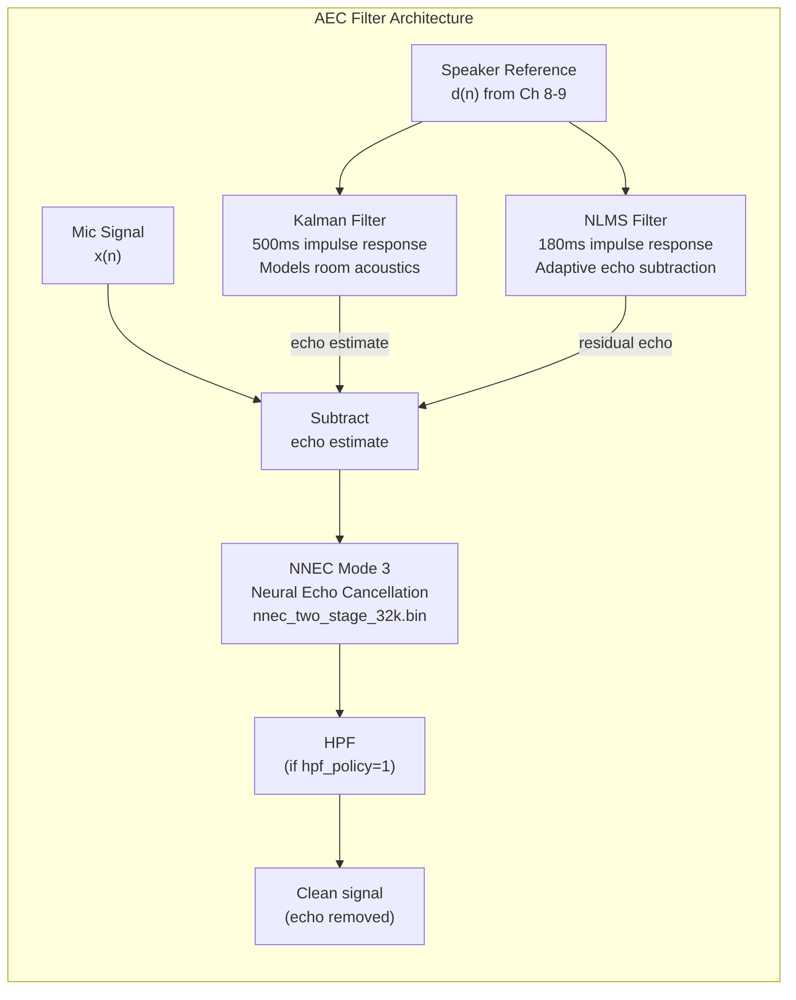

**Parameters:**
```json
{
  "aec": 1,
  "keep_hf": 0,
  "gain": 0.0,
  "hpf_policy": 0,
  "kalman": 1,
  "aec_nlms_filter_len_ms": 180,
  "aec_kalman_filter_len_ms": 500,
  "nnec": 3,
  "ec_aggr": 1.5,
  "rwpe_enable": 0
}
```

| Parameter | Value | Meaning |
|---|---|---|
| `aec` | 1 | AEC enabled |
| `kalman` | 1 | Kalman filter enabled |
| `aec_kalman_filter_len_ms` | 500 | 500ms echo tail modeling |
| `aec_nlms_filter_len_ms` | 180 | 180ms adaptive filter |
| `nnec` | 3 | Neural echo cancellation, mode 3 (most aggressive) |
| `ec_aggr` | 1.5 (meeting) / 2.0 (live) | Over-cancellation factor (>1.0 = aggressive) |
| `keep_hf` | 0 | Don't preserve high frequencies through AEC |
| `hpf_policy` | 0 | No high-pass filter |
| `rwpe_enable` | 0 | Residual WPE disabled |

**Neural model:** `nnec_two_stage_32k.bin` — Two-stage neural echo cancellation at 32kHz.

---

### 6.2 WPE (Weighted Prediction Error) — Meeting Only

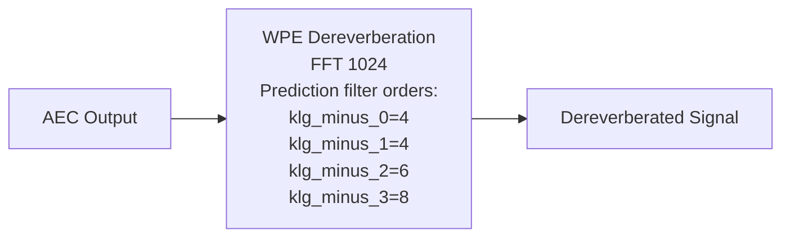

**Parameters:**
```json
{
  "use_wpe": 1,
  "wpe_fft_size": 1024,
  "wpe_reverb_det": 0,
  "klg_minus_0": 4,
  "klg_minus_1": 4,
  "klg_minus_2": 6,
  "klg_minus_3": 8
}
```

The WPE filter removes late reverberation by predicting the reverberant component from past frames. The `klg_minus_*` parameters control prediction filter order per sub-band.

---

### 6.3 CUSTOM (Neural Beamforming) — Live Only

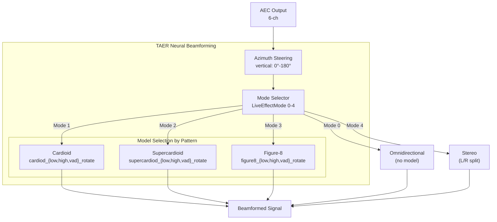

**Parameters:**
```json
{
  "first_node": 0,
  "az_enable": 1,
  "pre_gain": 0,
  "post_gain": 0,
  "aggr": 0.85,
  "vertical_start": 0,
  "vertical_end": 180
}
```

Each beamforming pattern has **3 neural models:**
- `*_low_rotate_model.bin` — Low-frequency beamforming
- `*_high_rotate_model.bin` — High-frequency beamforming
- `*_vad_rotate_model.bin` — VAD-guided adaptive beamforming

Total: **9 neural beamforming models** for the 3 directional patterns.

---

### 6.4 EXTRACT (Neural Pre-Mask)

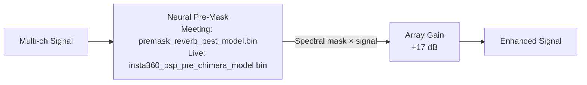

**Parameters:**
```json
{
  "array_gain": 17.0,
  "nn_aggr": 1.0,
  "cache_clear_policy": 1,
  "input_channel": 1,
  "nn_model_file": "premask_reverb_best_model-220000_model.bin"
}
```

| Parameter | Value | Meaning |
|---|---|---|
| `array_gain` | 17.0 dB | Gain applied after masking |
| `nn_aggr` | 1.0 | Neural mask aggressiveness (1.0 = full) |
| `cache_clear_policy` | 1 | Clear neural cache on mode changes |
| `input_channel` | 1 | Channel to extract |

---

### 6.5 ARRAY_SE (Array Signal Enhancement)

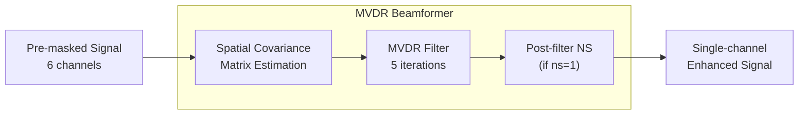

**Meeting pipeline:**
```json
{
  "ns": 0, "just_est_mask": 1,
  "hard_mask_thd": 0.0000001,
  "array_gain": 8.0,
  "nnmask6mic_mode": 0,
  "initial_echo_clip": 1,
  "array_ns": 5,
  "nnec": 3,
  "ns_aggr": 0.0,
  "mvdr_iters": 5, "mvdr_switch": 1,
  "use_dbss_mask": 0, "use_az_mask": 0
}
```

**Live pipeline:**
```json
{
  "ns": 1,
  "nnec": 0,
  "ns_aggr": 1.0,
  "scale_factor": 1
}
```

| Parameter | Meeting | Live | Effect |
|---|---|---|---|
| `ns` | 0 | 1 | Noise suppression off/on |
| `nnec` | 3 | 0 | Neural echo in array: aggressive / disabled |
| `ns_aggr` | 0.0 | 1.0 | NS aggressiveness: none / full |
| `mvdr_switch` | 1 | 1 | MVDR beamforming enabled in both |
| `mvdr_iters` | 5 | 5 | 5 iterations per frame in both |

---

### 6.6 NNPOST (Neural Post-Processing)

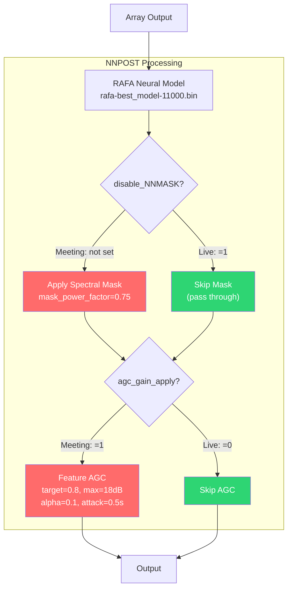

**Meeting pipeline (problematic):**
```json
{
  "nn_model_file": "rafa-best_model-11000_model.bin",
  "nnpost_aggr": 1.0,
  "mask_power_factor": 0.75,
  "agc_gain_apply": 1,
  "agc_target_level": 0.8,
  "agc_max_gain_in_dB": 18.0,
  "agc_threshold": 0.001,
  "agc_attack": 0.5,
  "agc_release": 0.5,
  "agc_alpha": 0.1,
  "feature_agc_enable": 1,
  "cache_clear_policy": 0,
  "group_num": 32,
  "group_size": 8,
  "smooth_high_freq": 112
}
```

**Live pipeline (faster recovery):**
```json
{
  "nn_model_file": "rafa-best_model-11000_model.bin",
  "disable_NNMASK": 1,
  "agc_gain_apply": 0,
  "low_cplx_mode": 1
}
```

**This is the key difference.** The meeting pipeline applies the RAFA neural mask AND the AGC, both of which converge slowly after silence. The live pipeline bypasses both.

---

### 6.7 PEQ (Parametric Equalizer) — Meeting Only

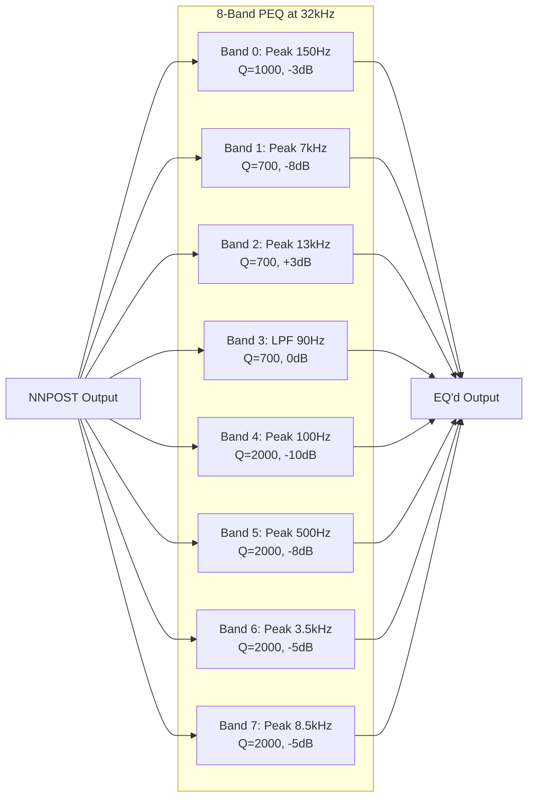

**Filter configuration:**
```json
{
  "peq_enable": 1,
  "process_ch": 1,
  "peq_sample_rate": 32000,
  "dynamic_headroom": 0,
  "peq_filter_nums": 8,
  "peq_filter_params": [
    {"id": 0, "p": [2, 150, 1000, -3000, 1]},
    {"id": 1, "p": [4, 7000, 700, -8000, 1]},
    {"id": 2, "p": [4, 13000, 700, 3000, 1]},
    {"id": 3, "p": [1, 90, 700, 0, 1]},
    {"id": 4, "p": [2, 100, 2000, -10000, 1]},
    {"id": 5, "p": [2, 500, 2000, -8000, 1]},
    {"id": 6, "p": [2, 3500, 2000, -5000, 1]},
    {"id": 7, "p": [2, 8500, 2000, -5000, 1]}
  ]
}
```

Filter type codes: `1=LPF, 2=Peak, 4=High-shelf`. Gain in millidB (÷1000 for dB).

---

### 6.8 MIXER_AGC (Automatic Mic Mixing)

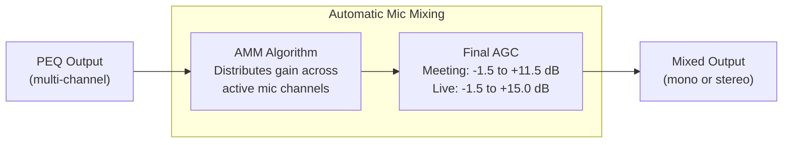

**Parameters:**
```json
{
  "agc": 1,
  "keep_hf": 0,
  "amm": 1,
  "amm_fake": 0,
  "agc_max_gain": 11.5,
  "agc_min_gain": -1.5,
  "agc_post_gain": 0.0,
  "stereo_enable": 0,
  "stereo_post_gain": 4.0,
  "stereo_min_gain_dB": -7.0,
  "stereo_max_gain_dB": 7.0
}
```

| Parameter | Meeting | Live |
|---|---|---|
| `agc_max_gain` | 11.5 dB | 15.0 dB |
| `agc_min_gain` | -1.5 dB | -1.5 dB |
| `amm` | 1 (enabled) | 1 (enabled) |
| `stereo_enable` | 0 | 0 |

---

### 6.9 DOA (Direction of Arrival)

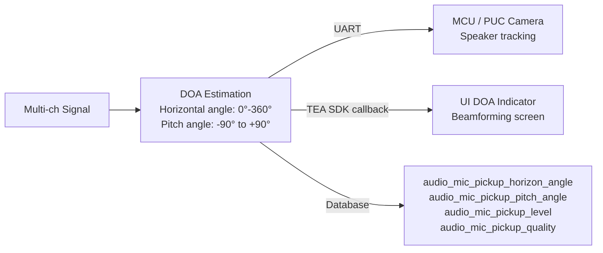

**Parameters:**
```json
{
  "upload_with_uart": 1,
  "upload_with_teasdk": 0
}
```

DOA data is sent to the MCU via UART for PUC camera speaker tracking (auto-framing mode).

---

## 7. AGC Chain Analysis

There are **multiple AGC stages** in the pipeline, each operating independently:

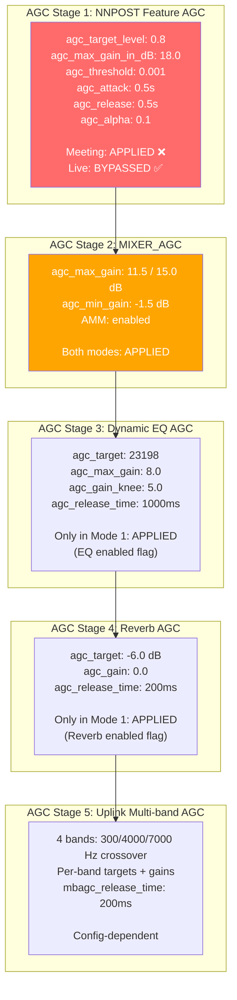

**In Noise Reduction mode (Mode 1), audio passes through up to 5 AGC stages.** Each independently estimates and applies gain, and each has its own convergence time. After silence, all 5 must independently ramp back up.

---

## 8. ASR Audio Path

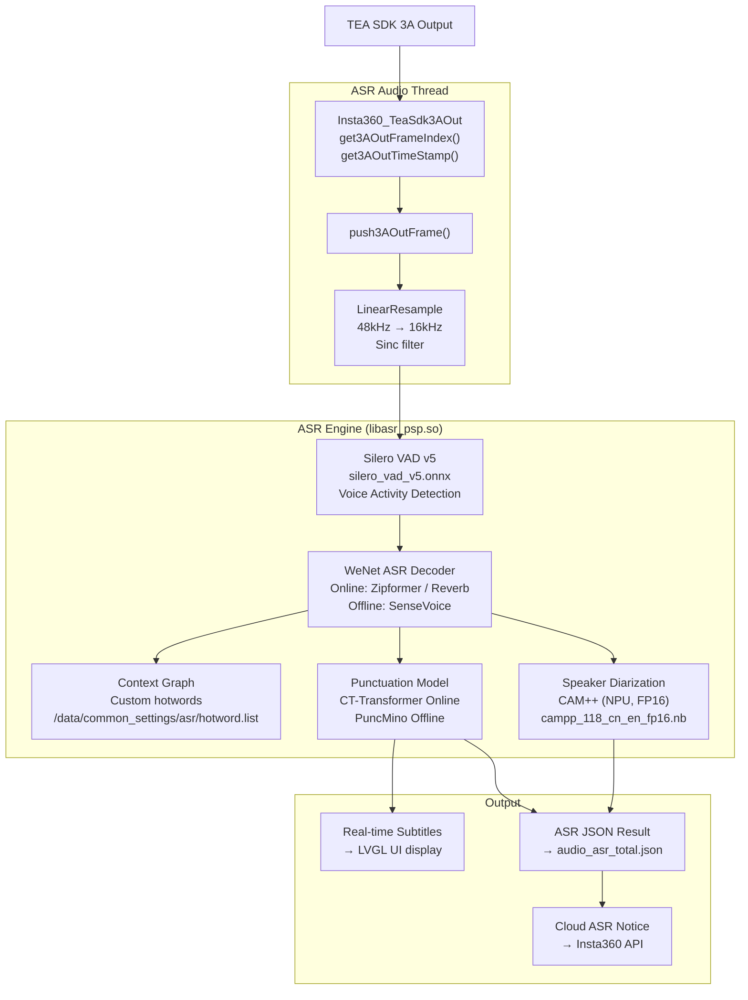

### ASR Model Selection

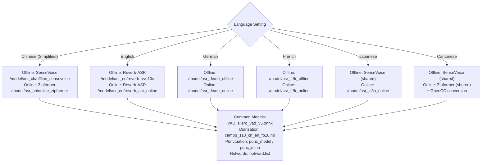

---

## 9. Audio Mode Switching

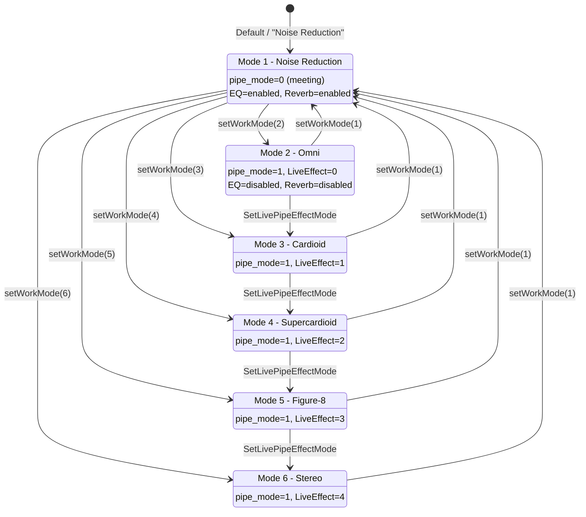

**Key code** (`Insta360_TeaSdk::setWorkMode`, line 18712):
- Mode 1: `SetProcessPipeWorkingMode(0)` + enable EQ + enable Reverb
- Modes 2-6: `SetProcessPipeWorkingMode(1)` + `SetLivePipeEffectMode(mode-2)` + disable EQ + disable Reverb

---

## 10. Dynamic EQ & Reverb Post-Processing

Only active in Mode 1 (Noise Reduction). Singletons `Insta360_EqProccess` and `Insta360_ReverbProccess`.

### Dynamic EQ (`/etc/dynamic_eq_config.json`)

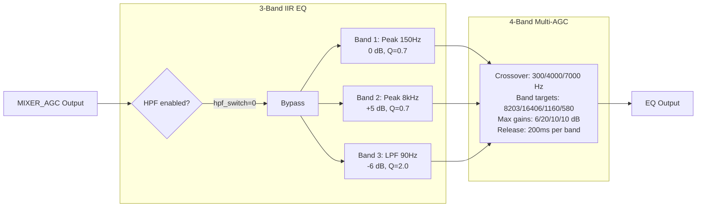

### Reverb Processing (`/etc/reverb_config.json`)

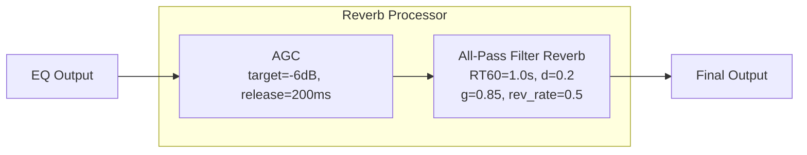

---

## 11. Debug & Dump Infrastructure

```mermaid
flowchart TD
    subgraph "Debug Flags"
        FLAG1["/tmp/AUDIO_VERBOSE"]
        FLAG2["/tmp/DUMP_ASR_TRANS_AUDIO"]
        FLAG3["/data/DOA_ENABLE"]
        FLAG4["Debug Screen Toggle<br/>PAGE_DEBUG (ID 88)"]
    end

    subgraph "Dump Outputs"
        D1["/mnt/udisk/audio_dump/<br/>Full pipeline PCM dumps"]
        D2["/mnt/udisk/asr_dump/<br/>ASR audio input dumps"]
        D3["/uplink_agc_in_dump.pcm"]
        D4["/uplink_agc_out_dump.pcm"]
        D5["/downlink_agc_in_dump.pcm"]
        D6["/downlink_agc_out_dump.pcm"]
        D7["/userdata/roomix/dump/<br/>TEA SDK internal dumps"]
    end

    FLAG1 --> D1
    FLAG2 --> D2
    FLAG4 --> D1 & D2

    subgraph "Activation"
        A1["Insta360_SetDumpEnable(1)"]
        A2["Debug screen: Audio DUMP toggles"]
        A3["Touch file: /tmp/DUMP_ASR_TRANS_AUDIO"]
    end
```

### How to Enable Audio Dumps

If you have root access (telnet/UART):

```bash
# Enable full audio pipeline dump
touch /tmp/AUDIO_VERBOSE

# Enable ASR audio dump
touch /tmp/DUMP_ASR_TRANS_AUDIO

# Enable DOA debug output
touch /data/DOA_ENABLE

# Dumps will appear in /mnt/udisk/audio_dump/ and /mnt/udisk/asr_dump/
# when a USB drive is connected or the internal storage is used

# View TEA SDK logs
tail -f /opt/logs/psp.log | grep AUDIOSERVER
```

---

## 12. Full Embedded Configuration

The complete TEA SDK pipeline configuration is embedded in `libTEAProcessSdk.so` at binary offset **`0x375688`** (12,078 bytes). It defines both the meeting and live pipelines with all parameters for all 8 processing stages.

### Extraction Command

```bash
python3 -c "
with open('libTEAProcessSdk.so', 'rb') as f:
    data = f.read()
start = None
for i, b in enumerate(data):
    if 32 <= b <= 126 or b in (9, 10, 13):
        if start is None: start = i
    else:
        if start and i - start > 500:
            region = data[start:i].decode('ascii', errors='replace')
            if '\"aec\"' in region and '\"ns\"' in region:
                print(region)
                break
        start = None
"
```

### Global Processing Parameters

| Parameter | Value | Unit |
|---|---|---|
| `frame_duration_ms` | 20 | ms |
| `input_sample_rate` | 48000 | Hz |
| `output_sample_rate` | 48000 | Hz |
| `process_sample_rate` | 32000 | Hz |
| `process_bit_depth` | 32 | bits |
| `process_channel_num` | 6 | channels |
| `common_fft_size` | 1024 | samples |
| `common_hop_size` | 640 | samples |
| `process_pcm_dB_gain` | 13.0 (meeting) / 18.0 (live) | dB |

### Thread-to-Core Assignment

```mermaid
gantt
    title Pipeline Thread Distribution Across CPU Cores
    dateFormat X
    axisFormat %s

    section Core 1
    AEC (Thread 1)          :0, 1

    section Core 2
    WPE/CUSTOM (Thread 7)   :0, 1
    EXTRACT (Thread 2)      :1, 2
    NNPOST (Thread 4)       :2, 3
    DOA (Thread 6)          :3, 4

    section Core 3
    ARRAY_SE (Thread 3)     :0, 1
    PEQ (Thread 8)          :1, 2
    MIXER_AGC (Thread 5)    :2, 3
```

The pipeline uses 3 of the 4 available Cortex-A53 cores (Core 0 reserved for Linux kernel + application). Processing is pipelined: AEC runs on Core 1 while ARRAY_SE runs on Core 3, allowing parallel execution of independent stages.

---

### Neural Model Summary

| Model | File | Stage | Purpose | Size |
|---|---|---|---|---|
| NNEC | `nnec_two_stage_32k.bin` | AEC | Neural echo cancellation | ~2 MB |
| Premask Reverb | `premask_reverb_best_model-220000_model.bin` | EXTRACT (meeting) | Dereverberation mask | ~3 MB |
| Chimera | `insta360_psp_pre_chimera_model.bin` | EXTRACT (live) | Multi-channel separation mask | ~3 MB |
| RAFA | `rafa-best_model-11000_model.bin` | NNPOST | Noise suppression mask | ~2 MB |
| TAER Cardioid ×3 | `insta360_az_taer_cardiod_{low,high,vad}_rotate_model.bin` | CUSTOM (live) | Cardioid beamforming | ~1 MB each |
| TAER Supercardioid ×3 | `insta360_az_taer_supercardiod_{low,high,vad}_rotate_model.bin` | CUSTOM (live) | Supercardioid beamforming | ~1 MB each |
| TAER Figure-8 ×3 | `insta360_az_taer_figure8_{low,high,vad}_rotate_model.bin` | CUSTOM (live) | Figure-8 beamforming | ~1 MB each |
| Solo Steady | `insta360_nnpost_solo_steedy.bin` | NNPOST | Solo speaker steady-state | ~1 MB |
| MCH Pre Chimera | `insta360_psp_mchpre_chimera_model.bin` | EXTRACT | Multi-channel pre-processing | ~3 MB |

**Total: 15 neural models**, all running on the ARM Cortex-A53 CPU (ONNX Runtime) or VeriSilicon NPU (`.nb` format for CAM++ diarization).

---

*Document generated from Ghidra decompilation and binary analysis. Pipeline configuration extracted from libTEAProcessSdk.so at offset 0x375688.*
