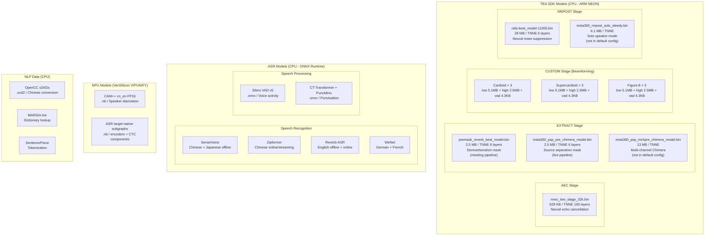

# Insta360 Wave — AI Models Inventory

All AI/ML models extracted from firmware v1.1.6.6. Models are split across two locations:
- **TEA SDK models** (`/usr/bin/tea_models/`) — Audio enhancement, embedded in rootfs (75.5 MB total)
- **ASR models** (`/model/` partition) — Speech recognition, on a separate 3 GB ext4 partition
- **S2T data** (`/usr/lib/s2t_data/`) — Chinese character conversion dictionaries (1 MB total)

Extracted copies are in `docs/ai-models/`.

## NPU Portability Update (2026-07-28)

The stock NBG corpus and live controls show that target-native ASR and
speaker-model `.nb` files execute through the Wave NPU stack. Repository code
also generated and executed one tiny Erf NBG for target `0x1000000e`.

This does **not** mean the TNNE audio-enhancement models can be copied to the
NPU. The RAFA/NNEC/Chimera models remain CPU/TEA references. Fixed MatrixMul
and Conv2d custom denoiser graphs were recognized by TIM-VX but rejected at
NBG export and ordinary graph verification before inference. See the
[`PoC 8 audio boundary`](npu/lab-notebook/2026-07-28-poc8-audio-denoiser-boundary.md).

PoC 9E/9F adds bounded general ONNX admission and deterministic CPU/hybrid
fallback. The real Silero VAD model audits as a 51-graph, 689-node
control-flow model and remains entirely CPU-resident because no exact NPU
graph signature or compatible general compiler is approved. The fixed
Conv/Sigmoid spectral-mask control is also CPU-only; it is a numerical
control, not a trained denoiser. See the
[`ONNX evidence`](npu/onnx/README.md).

PoC 9D narrows the compiler blocker. A trusted vendor package contains the
exact Wave profile and a real `VIV_GPU_FILE` parser, but only in
`6.4.18:967862` shader compilers that do not emit graph NBG. Its Acuity NBG
path uses an embedded `6.4.6:769531` simulator SDK. A custom
noise-cancelling model therefore remains CPU-correct and CPU-resident unless
either a dedicated x86-64 no-kernel SDK `>=6.4.22` is acquired and passes
the fixed-Conv gates, or the independent serializer route later recovers
coefficient packing and operation emission. See the
[`compiler-acquisition notebook`](npu/lab-notebook/2026-07-28-poc9d-compiler-acquisition-static-qualification.md).

PoC 12C advances that serializer route without changing model placement. It
recovers the v2 header checksum and the section-20/26 dynamic-I/O
`(offset,size)` table, validates 138/138 Wave graphs and 8,939 table entries,
and reproduces one controlled four-byte constant change exactly in memory.
This is useful groundwork for a serializer, but it does not identify Conv,
MatrixMul, recurrent-state, or coefficient encodings and does not provide
general ONNX support. No noise-cancellation graph was emitted or executed.
The hybrid runner therefore continues to use one CPU session and zero NPU
attempts. See the
[`PoC 12C notebook`](npu/lab-notebook/2026-07-29-poc12c-dyna-io-crc-profile.md).

## Learned Erf-Mask Update (2026-07-29)

PoCs 13A–13F supersede the earlier “no noise-cancellation graph executed”
status for one deliberately narrow model. A deterministic 962-parameter
spectral-mask estimator now runs its exact quantized U8 `[481]` Erf
partition on the Wave NPU. The CPU retains feature extraction, a
DeepFilterNet candidate, the causal DFN-or-Erf selector, and waveform
synthesis.

The frozen 12-second fixture used all 1,201 returned NPU tensors to
reconstruct 576,000 samples. The NPU bytes and output samples exactly matched
the CPU reference, while median SI-SDR improved by 4.8443 dB and noise-only
attenuation reached 9.8283 dB. The exact partition also passed a
10,000-execution numerical and health soak.

This is custom-model support for one sealed Erf partition, not general ONNX
support and not a port of the stock TNNE RAFA, NNEC, or Chimera models.
Production Rust/audio-service integration is still incomplete. See the
[`Erf-mask result`](npu/models/erf-mask/README.md) and
[`completion audit`](npu/models/erf-mask/completion-audit.md).

PoC 14 tested the next placement boundary. A quality-qualified
`Multiply -> Add -> Erf` model exists on the host, but the exact Wave
TIM-VX checker rejects its asymmetric-U8/per-channel-I8 Multiply before NBG
emission. The larger affine partition is therefore not NPU-approved; the
supported layout remains CPU affine plus sealed NPU Erf. See the
[`PoC 14B notebook`](npu/lab-notebook/2026-07-29-poc14b-affine-compiler-negative.md).

---

## Model Format Reference

| Format | Magic Bytes | Origin | Runtime |
|---|---|---|---|
| **TNNE** | `tnne\r\n` or `tnne\n` | Roomix TEA SDK, PyTorch-trained | TEA SDK (CPU, ARM NEON) |
| **Versioned binary** | `version:0.1\n<timestamp>` | Roomix beamforming coefficients | TEA SDK (CPU) |
| **ONNX** | Standard ONNX protobuf | Open format | ONNX Runtime 1.15.1 (CPU) |
| **NBG (.nb)** | VeriSilicon NBG format | Compiled for Amlogic NPU | libnnsdk / ADLA (NPU hardware) |
| **OCD2** | OpenCC dictionary v2 | OpenCC project | libopencc (CPU) |

---

## 1. TEA SDK Audio Models (75.5 MB)

Located at `/usr/bin/tea_models/` on the device. Loaded by `libTEAProcessSdk.so` (Roomix v3.10.1.1153).

### 1.1 RAFA Noise Suppression

| Property | Value |
|---|---|
| **File** | `rafa-best_model-11000_model.bin` |
| **Size** | 28 MB |
| **Format** | TNNE (6 layers, PyTorch-trained) |
| **Pipeline stage** | NNPOST (Stage 4) |
| **Active in** | Both meeting and live pipelines |
| **Purpose** | Neural noise suppression via spectral masking |

The RAFA (likely "Robust Adaptive Frequency Attention") model is the largest and most critical audio model. It creates a time-frequency mask that is applied to the signal to suppress noise while preserving speech.

**How it works:**
1. Takes the beamformed signal as input (32kHz, FFT bins)
2. Estimates a spectral mask per time-frequency bin (0.0 = suppress, 1.0 = pass)
3. Mask is applied with `mask_power_factor=0.75` (softer than binary masking)
4. Groups of 32 frequency bins × 8 are processed together (`group_num=32, group_size=8`)
5. High frequencies above bin 112 are smoothed separately (`smooth_high_freq=112`)

**Configuration:**
```json
{
  "nn_model_file": "rafa-best_model-11000_model.bin",
  "nnpost_aggr": 1.0,
  "mask_power_factor": 0.75,
  "feature_agc_enable": 1,
  "agc_gain_apply": 1,
  "agc_target_level": 0.8,
  "agc_max_gain_in_dB": 18.0,
  "agc_threshold": 0.001,
  "agc_attack": 0.5,
  "agc_release": 0.5,
  "agc_alpha": 0.1
}
```

**Note:** In the live pipeline, the RAFA model is loaded but its mask is **bypassed** (`disable_NNMASK=1`) and AGC is not applied (`agc_gain_apply=0`). Only the feature extraction runs.

---

### 1.2 NNEC (Neural Echo Cancellation)

| Property | Value |
|---|---|
| **File** | `nnec_two_stage_32k.bin` |
| **Size** | 628 KB |
| **Format** | TNNE (165 layers, multi-band) |
| **Pipeline stage** | AEC (Stage 1) and ARRAY_SE (Stage 3) |
| **Active in** | Both pipelines (AEC always; ARRAY_SE meeting only) |
| **Purpose** | Neural residual echo suppression after linear AEC |

Two-stage neural echo cancellation operating at 32kHz. Processes multiple sub-bands defined by the header:

```
bands:(0,4),(3,3),(5,3),(7,3),(9,3),(11,3)...
```

Each band covers a range of frequency bins. The model estimates residual echo that the linear Kalman/NLMS filters couldn't remove, particularly non-linear echo components (speaker distortion, harmonic echo).

**NNEC modes:**
| Mode | Aggressiveness | Used in |
|---|---|---|
| 0 | Disabled | Live pipeline ARRAY_SE |
| 1 | Light | Not used in default config |
| 2 | Medium | Not used in default config |
| 3 | Aggressive | Meeting pipeline AEC + ARRAY_SE; Live pipeline AEC |

---

### 1.3 Premask Reverb Model

| Property | Value |
|---|---|
| **File** | `premask_reverb_best_model-220000_model.bin` |
| **Size** | 2.5 MB |
| **Format** | TNNE (6 layers, PyTorch-trained) |
| **Pipeline stage** | EXTRACT (Stage 2, meeting pipeline only) |
| **Active in** | Meeting pipeline |
| **Purpose** | Neural dereverberation pre-mask |

Creates a spectral mask that suppresses late reverberation (room reflections) before the array processing stage. Works in conjunction with the WPE (Weighted Prediction Error) linear dereverberation.

**Configuration:**
```json
{
  "nn_model_file": "premask_reverb_best_model-220000_model.bin",
  "array_gain": 17.0,
  "nn_aggr": 1.0,
  "cache_clear_policy": 1
}
```

---

### 1.4 Chimera Pre-Mask Model

| Property | Value |
|---|---|
| **File** | `insta360_psp_pre_chimera_model.bin` |
| **Size** | 2.5 MB |
| **Format** | TNNE (6 layers, PyTorch-trained) |
| **Pipeline stage** | EXTRACT (Stage 2, live pipeline only) |
| **Active in** | Live (beamforming) pipeline |
| **Purpose** | Multi-channel source separation pre-mask |

The Chimera network (named after the deep clustering architecture from [Luo et al.]) performs multi-channel source separation. It creates masks that separate target speech from interference, working with the directional beamforming in the CUSTOM stage.

---

### 1.5 Multi-Channel Pre-Chimera Model

| Property | Value |
|---|---|
| **File** | `insta360_psp_mchpre_chimera_model.bin` |
| **Size** | 13 MB |
| **Format** | TNNE (PyTorch-trained) |
| **Pipeline stage** | EXTRACT (alternative) |
| **Active in** | Not in default config (likely backup or multi-channel variant) |
| **Purpose** | Extended multi-channel Chimera source separation |

Larger variant of the Chimera model. The "mch" prefix suggests it processes more microphone channels simultaneously. At 13 MB, it's significantly larger than the 2.5 MB single-channel variant.

---

### 1.6 Solo Steady Model

| Property | Value |
|---|---|
| **File** | `insta360_nnpost_solo_steedy.bin` |
| **Size** | 6.1 MB |
| **Format** | TNNE (PyTorch-trained) |
| **Pipeline stage** | NNPOST (alternative) |
| **Active in** | Not in default config (likely solo speaker mode) |
| **Purpose** | Steady-state noise suppression for single speaker |

Optimized for scenarios with a single steady speaker (e.g., podcast, presentation). "Steady" suggests it's tuned for stationary noise environments where the speaker doesn't move.

---

### 1.7 TAER Beamforming Models (9 models)

Neural beamforming models using the TAER (Time-domain Adaptive Echo Reduction / Azimuth Estimation and Rotation) architecture. Each beamforming pattern has 3 variants.

#### Cardioid Pattern

| File | Size | Variant | Purpose |
|---|---|---|---|
| `insta360_az_taer_cardiod_low_rotate_model.bin` | 5.1 MB | Low-frequency | Beamforming for frequencies below crossover |
| `insta360_az_taer_cardiod_high_rotate_model.bin` | 2.5 MB | High-frequency | Beamforming for frequencies above crossover |
| `insta360_az_taer_cardiod_vad_rotate_model.bin` | 4.3 KB | VAD | Voice activity detection for adaptive steering |

#### Supercardioid Pattern

| File | Size | Variant | Purpose |
|---|---|---|---|
| `insta360_az_taer_supercardiod_low_rotate_model.bin` | 5.1 MB | Low-frequency | Narrower pickup than cardioid |
| `insta360_az_taer_supercardiod_high_rotate_model.bin` | 2.5 MB | High-frequency | Narrower pickup than cardioid |
| `insta360_az_taer_supercardiod_vad_rotate_model.bin` | 4.3 KB | VAD | Voice activity detection |

#### Figure-8 Pattern

| File | Size | Variant | Purpose |
|---|---|---|---|
| `insta360_az_taer_figure8_low_rotate_model.bin` | 5.1 MB | Low-frequency | Bidirectional (front + back) |
| `insta360_az_taer_figure8_high_rotate_model.bin` | 2.5 MB | High-frequency | Bidirectional (front + back) |
| `insta360_az_taer_figure8_vad_rotate_model.bin` | 4.3 KB | VAD | Voice activity detection |

**Format:** Versioned binary (`version:0.1\n1701736564\n` — timestamp Dec 4, 2023)

The "rotate" suffix indicates these models support azimuth rotation — the beamforming pattern can be steered to any direction by rotating the model coefficients. The `az_enable=1` and `aggr=0.85` parameters control this in the CUSTOM pipeline stage.

**How the 3 variants work together:**
1. **VAD model** (4.3 KB) — Fast voice activity detection, determines when speech is present
2. **Low model** (5.1 MB) — Beamforming filter for low frequencies (longer wavelengths need different spatial processing)
3. **High model** (2.5 MB) — Beamforming filter for high frequencies (shorter wavelengths, more spatial resolution)

The low/high split is necessary because microphone array beamforming is frequency-dependent — low frequencies have wavelengths larger than the array aperture, requiring different processing than high frequencies.

---

## 2. ASR Models (on /model partition, ~3 GB)

Located at `/model/` on a separate ext4 partition. Not extractable from the rootfs (separate eMMC partition). Referenced by `libasr_psp.so` (ASR engine v0.4.23).

### 2.1 Speech Recognition Models

| Language | Offline Model | Online Model | Framework |
|---|---|---|---|
| **Chinese (Simplified)** | `/model/asr_ch/offline_sensevoice` | `/model/asr_ch/online_zipformer` | SenseVoice / Zipformer |
| **English** | `/model/asr_en/reverb-asr-10s` | `/model/asr_en/reverb_asr_online` | Reverb-ASR (WeNet) |
| **German** | `/model/asr_de/de_offline` | `/model/asr_de/de_online` | WeNet |
| **French** | `/model/asr_fr/fr_offline` | `/model/asr_fr/fr_online` | WeNet |
| **Japanese** | SenseVoice (shared with Chinese) | `/model/asr_ja/ja_online` | SenseVoice / WeNet |
| **Cantonese** | SenseVoice (shared) + OpenCC | Zipformer (shared) + OpenCC | SenseVoice + OpenCC |

**Model architectures:**

| Architecture | Origin | Type | Used for |
|---|---|---|---|
| **SenseVoice** | Alibaba FunAudioLLM | Encoder-decoder, multilingual | Chinese + Japanese offline |
| **Zipformer** | k2-fsa/icefall | Streaming transducer | Chinese online/streaming |
| **Reverb-ASR** | WeNet + reverb augmentation | CTC/Attention hybrid | English (trained for conference room acoustics) |
| **WeNet** | WeNet community | CTC/Attention hybrid | German, French |

Runtime follows the deployed file and caller: ONNX variants use CPU ONNX
Runtime, while the many target-native `.nb` subgraphs use
`libnnsdk`/VIPUNIFY on the NPU. The strict corpus contains 138 Wave-targeted
v2 NBG files when the explicit live CTC reference is included.

### 2.2 Voice Activity Detection

| Property | Value |
|---|---|
| **File** | `/model/vad/silero_vad_v5.onnx` |
| **Format** | ONNX |
| **Origin** | [Silero VAD v5](https://github.com/snakers4/silero-vad) (open source) |
| **Runtime** | ONNX Runtime 1.15.1 (CPU) |
| **Purpose** | Detect speech vs. silence segments |

Silero VAD is a lightweight, production-quality voice activity detector. It runs before the ASR decoder to segment audio into speech regions, reducing unnecessary computation.

### 2.3 Speaker Diarization

| Property | Value |
|---|---|
| **File** | `/model/diarization/campp_118_cn_en_fp16.nb` |
| **ONNX source** | `ONNX_CAMPPlus_118_cn_en.onnx` (compiled to NBG) |
| **Format** | VeriSilicon NBG (FP16 quantized) |
| **Origin** | [CAM++](https://github.com/modelscope/3D-Speaker) (Alibaba ModelScope) |
| **Runtime** | **Amlogic NPU** via libnnsdk/ADLA |
| **Purpose** | Speaker embedding extraction for "who said what" |

CAM++ is a clearly identified NPU model, but it is not the only NPU graph:
the ASR tree contains many target-native NBG subgraphs. CAM++ (Class-Aware
Modulation with enhanced features) extracts speaker embeddings—fixed-length
vectors that represent a speaker's voice characteristics. These embeddings
are compared to identify and label different speakers in a meeting.

The model supports Chinese and English speakers (`cn_en`), uses FP16 quantization for NPU efficiency, and the `.nb` format is VeriSilicon's Network Binary Graph compiled for the specific NPU hardware.

**Speaker diarization flow:**
1. Audio segmented by VAD
2. Speaker embeddings extracted by CAM++ (NPU)
3. Embeddings clustered to identify speakers
4. Speaker labels assigned to ASR transcript segments
5. Results stored per meeting with `speakerId` and `speakerName`

Storage paths:
- Enrollment data: `/mnt/udisk/common_settings/asr/identification_dataset`
- Per-meeting data: `/mnt/udisk/common_settings/asr/identification_meeting`

### 2.4 Punctuation Restoration

| Property | Value |
|---|---|
| **Files** | `/model/punc_model/` and `/model/punc_mino/` |
| **Format** | ONNX |
| **Architecture** | CT-Transformer (online), PuncMino (offline) |
| **Runtime** | ONNX Runtime 1.15.1 (CPU) |
| **Purpose** | Add punctuation to raw ASR text output |

Two punctuation models:
- **CT-Transformer Online** — Streaming punctuation for real-time subtitles
- **PuncMino** — Higher quality offline punctuation for final transcription

### 2.5 Model Version Tracking

The file `/model/model_version.txt` contains the model pack version. The code checks for `"V2.0.0"` before loading models. The JSON header of the SWU firmware reports `model_md5: "a21d244e871aee5efb1ce581d771e2db"`.

---

## 3. Chinese Conversion Data (1 MB)

Located at `/usr/lib/s2t_data/`. Used by `libopencc.so` for Simplified↔Traditional Chinese conversion, particularly for Cantonese transcription.

| File | Size | Purpose |
|---|---|---|
| `STCharacters.ocd2` | 44 KB | Simplified → Traditional character mapping |
| `STPhrases.ocd2` | 906 KB | Simplified → Traditional phrase mapping |
| `TSCharacters.ocd2` | 45 KB | Traditional → Simplified character mapping |
| `TSPhrases.ocd2` | 9.6 KB | Traditional → Simplified phrase mapping |
| `s2t.json` | 406 B | Conversion config (Simplified → Traditional) |
| `t2s.json` | 406 B | Conversion config (Traditional → Simplified) |

Format: OpenCC Dictionary v2 (`.ocd2`), a trie-based compiled dictionary from the [OpenCC](https://github.com/BYVoid/OpenCC) project (open source).

---

## 4. NLP Libraries

### MARISA Trie

`libmarisa.so` (154 KB) — [MARISA-trie](https://github.com/s-yata/marisa-trie) (open source). Used by the ASR engine for fast dictionary/lexicon lookup during decoding.

### Sentence Piece

`libssentencepiece_core.so` (121 KB) — [SentencePiece](https://github.com/google/sentencepiece) tokenizer (open source). Subword tokenization for ASR models (BPE/Unigram tokenization).

---

## 5. Complete Model Map



---

## 6. Runtime & Inference Engines

| Engine | Version | Models | Hardware |
|---|---|---|---|
| **TEA SDK** | 3.10.1.1153 | 15 TNNE/binary models | ARM Cortex-A53 CPU + NEON SIMD |
| **ONNX Runtime** | 1.15.1 | ASR, VAD, Punctuation | ARM Cortex-A53 CPU |
| **libnnsdk / VIPUNIFY** | galcore 6.4.19.5 | ASR/diarization target-native `.nb` graphs | VeriSilicon NPU; runtime-controlled clock |
| **libopencc** | - | OCD2 dictionaries | CPU |
| **libmarisa** | - | Trie dictionaries | CPU |

### NPU Frequency Setting

An older audio-init path contains:
```bash
echo 350000000 > /sys/module/galcore/parameters/nanoqFreq
```

The accepted 2026-07-28 PoCs observed and pinned `nanoqFreq=838860800`.
The clock is therefore runtime-controlled; do not describe the device as
permanently running at 350 MHz or write this sysfs parameter during research.

### License Enforcement

The TEA SDK models require a valid license checked by `tea_license.ko` (kernel module) and verified at runtime by `TeaProcessSdk::VerifyLicense()`. Failure logs "check license failed" but does not appear to block operation (returns -1).

---

## 7. Open Source Equivalents

| Model | Open Source Alternative | Link |
|---|---|---|
| RAFA noise suppression | RNNoise / DTLN | https://github.com/xiph/rnnoise |
| NNEC echo cancellation | WebRTC AEC3 | https://webrtc.googlesource.com/src/ |
| Chimera source separation | Asteroid / SpeechBrain | https://github.com/asteroid-team/asteroid |
| TAER beamforming | BeamformIt / ODAS | https://github.com/introlab/odas |
| SenseVoice ASR | SenseVoice | https://github.com/FunAudioLLM/SenseVoice |
| Zipformer ASR | icefall/Zipformer | https://github.com/k2-fsa/icefall |
| Silero VAD | Silero VAD | https://github.com/snakers4/silero-vad |
| CAM++ diarization | 3D-Speaker/CAM++ | https://github.com/modelscope/3D-Speaker |
| OpenCC | OpenCC | https://github.com/BYVoid/OpenCC |
| MARISA trie | MARISA-trie | https://github.com/s-yata/marisa-trie |
| SentencePiece | SentencePiece | https://github.com/google/sentencepiece |

---

*Models extracted from Insta360 Wave firmware v1.1.6.6 (Nov 28, 2025). TEA SDK models are in `docs/ai-models/tea-sdk/`, S2T data in `docs/ai-models/s2t-data/`. ASR models reside on the 3 GB `/model` partition and are not included (require device extraction).*
