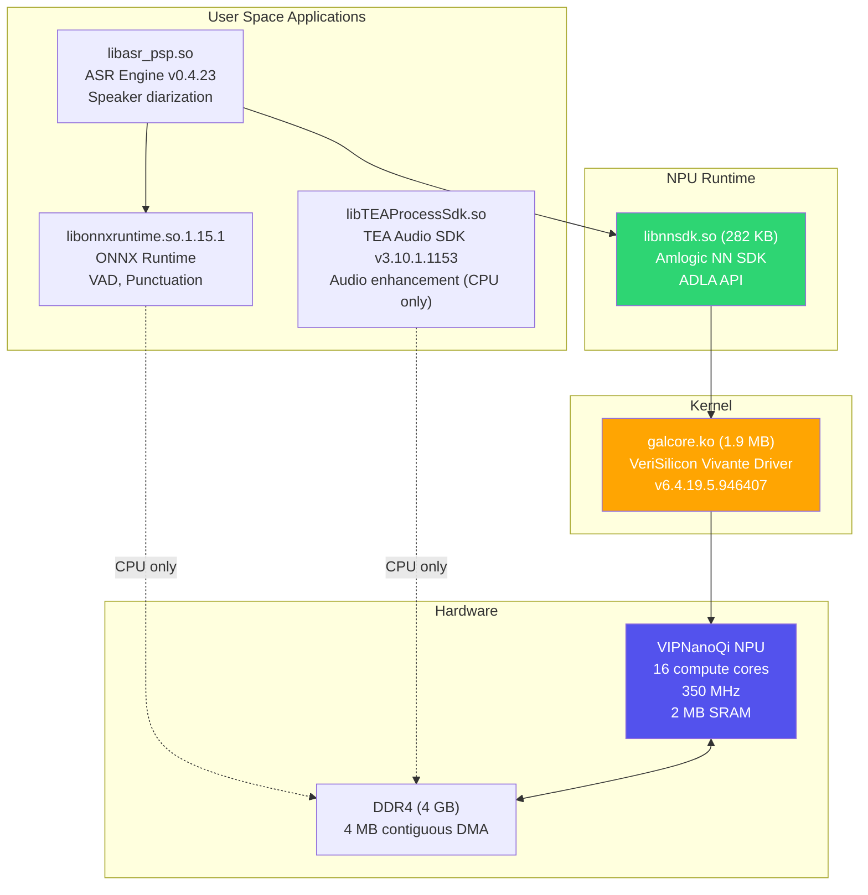
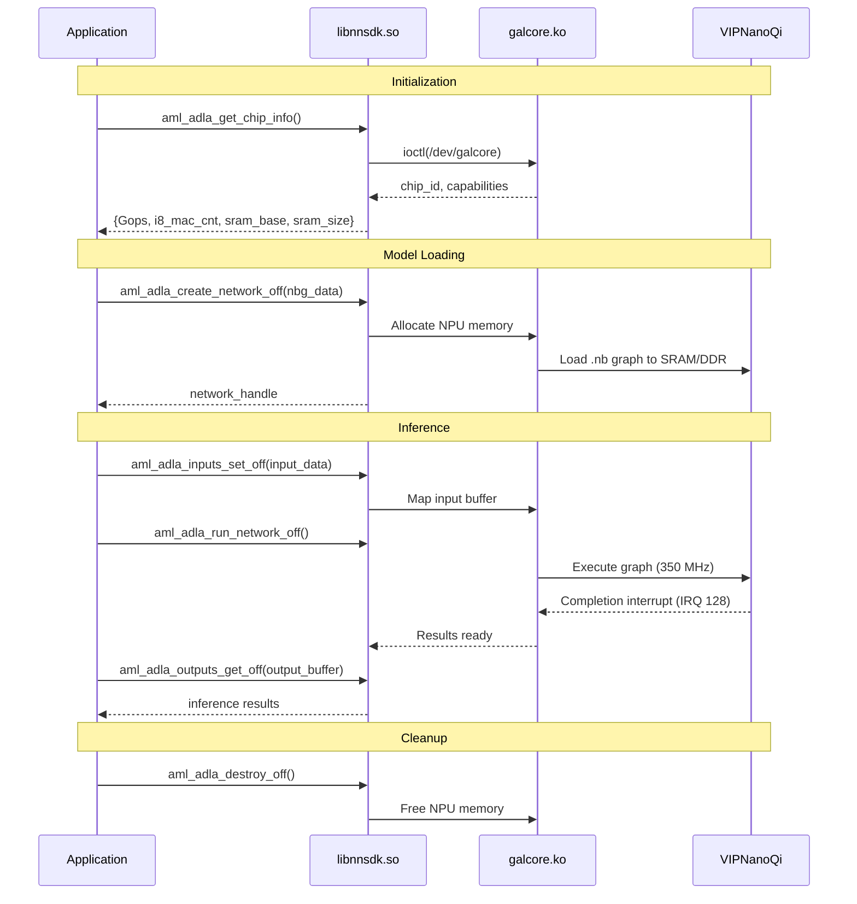
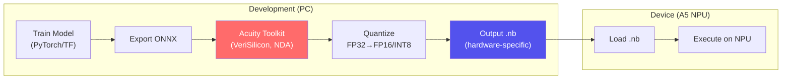
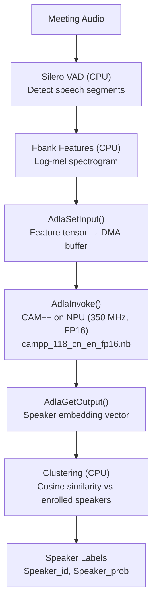
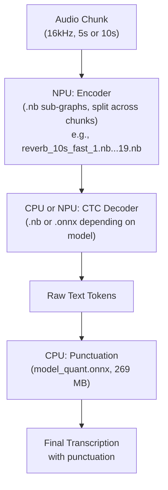
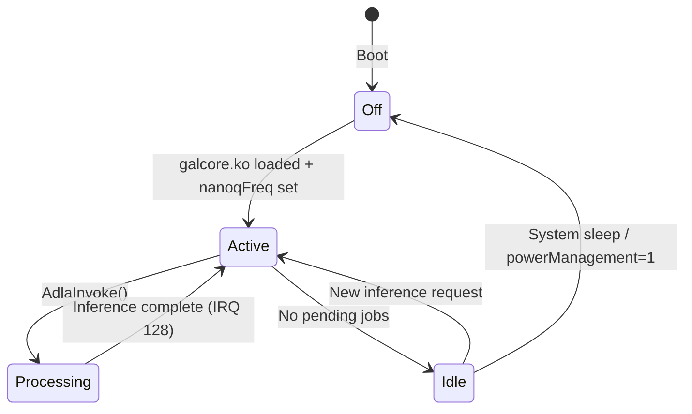

# Insta360 Wave — NPU (Neural Processing Unit) Deep Dive

The Insta360 Wave uses an **Amlogic A5 SoC** with an integrated **VeriSilicon VIPNanoQi NPU** for hardware-accelerated neural network inference. All data in this document is verified from the **live device** via ADB root shell.

## Live Custom-Process Inference Result (2026-07-23)

NPU access from code we control is now proven beyond context creation.
The Rust `waved-npu-probe` loads the device's stock `libnnsdk.so`,
queries NBG tensor metadata, submits an input, runs an existing
Wave-targeted CTC graph, retrieves its output, and destroys the graph.

Three deterministic runs returned the same nonzero 332,800-byte output
(SHA-256
`e621b2134934ab94ab83049b4b56e5bb410831de41d9727aaf95384d413b52d4`)
in 3.501, 2.184, and 2.263 ms. A second complete invocation also passed.
The stock `waved` process and NPU parameters were unchanged.

The current custom add graph does **not** run because its host compiler
emits product target `0x10000020`; the Wave's stock graphs target
`0x1000000e`. `libnnsdk` reports `hardware version is not in product
list` during graph creation. Thus:

- Direct NPU inference from our process: **working**.
- Loading a correctly targeted external NBG: **working**.
- Compiling arbitrary ONNX models with the repository's current host
  SDK: **blocked by the missing Wave/VIP9000 archmodel and compiler
  target**.

The PoC source is under `waved/crates/waved-npu-probe/`; the full
reproduction record is in `waved/docs/COMPUTE_HARDWARE.md`.

---

## 1. NPU Hardware (Verified from Live Device)

### Specifications

| Property | Value | Source |
|---|---|---|
| **SoC** | Amlogic A5 (AV400) | Build paths, board name `AmlSpeaker` |
| **NPU IP** | VeriSilicon VIPNanoQi | `cts_vipnanoq_*` clock names in DT |
| **Driver** | `galcore.ko` v6.4.19.5.946407 | `strings galcore.ko` |
| **License** | Dual MIT/GPL | Module description |
| **Device node** | `/dev/galcore` (major 199, minor 0) | `ls -la /dev/galcore` |
| **DT compatible** | `amlogic, galcore` | `/proc/device-tree/galcore/compatible` |
| **Clock** | 350 MHz (set at audio init) | `nanoqFreq` parameter |
| **NN Power Version** | 6 | `/proc/device-tree/galcore/nn_power_version` |
| **Compute cores** | 16 | `devCoreCounts` parameter |
| **On-chip SRAM** | 2 MB at `0xF7000000` | DT `reg` / `NN_SRAM` |
| **Register space** | 256 KB at `0xFDB00000` | DT `reg` / `NN_REG` |
| **DMA buffer** | 4 MB contiguous | `contiguousSize` parameter |
| **MMU** | Enabled | `mmu` parameter |
| **INT8 MACs** | Hardware supported | `adla i8 mac_cnt` in libnnsdk |
| **FP16** | Supported (CAM++ runs in FP16) | Model filename `_fp16.nb` |
| **IRQ** | GIC SPI 128, edge-triggered | DT `interrupts` |

### Memory Map (from Device Tree)

```
┌──────────────────────────────────────────────────┐
│  Address Range              │ Size    │ Name     │
├──────────────────────────────────────────────────┤
│  0xFDB00000 - 0xFDB3FFFF   │ 256 KB  │ NN_REG   │  NPU control registers
│  0xF7000000 - 0xF71FFFFF   │ 2 MB    │ NN_SRAM  │  On-chip fast SRAM
│  0xFE00C040                 │ 4 B     │ NN_MEM0  │  Memory control
│  0xFE00C044 (inferred)      │ 4 B     │ NN_MEM1  │  Memory control
│  (DT entry)                 │         │ NN_RESET │  Reset control
│  (DT entry)                 │         │ NN_CLK   │  Clock control
└──────────────────────────────────────────────────┘
```

### Clocks

| Clock | Purpose |
|---|---|
| `cts_vipnanoq_axi_clk_composite` | AXI bus interface clock (memory access) |
| `cts_vipnanoq_core` | Core processing clock — **set to 350 MHz** at boot |

The firmware sets the clock at audio initialization (`Insta360_InitAudio`):
```bash
echo 350000000 > /sys/module/galcore/parameters/nanoqFreq
```

### galcore Driver Parameters (All Values from Live Device)

| Parameter | Value | Description |
|---|---|---|
| `nanoqFreq` | 350000000 | NPU clock frequency (350 MHz) |
| `enableNN` | 255 | All NN features enabled (bitmask) |
| `devCoreCounts` | 16,0 | 16 compute cores on device 0 |
| `dev2DCoreCounts` | 4,0 | 4 2D cores on device 0 |
| `contiguousSize` | 4194304 | 4 MB contiguous DMA buffer |
| `registerMemBase` | 2147483648 | 0x80000000 |
| `registerMemSize` | 131072 | 128 KB |
| `mmu` | 1 | MMU enabled |
| `mmuDynamicMap` | 1 | Dynamic MMU mapping |
| `mmuCmdPool` | 1 | Command pool MMU |
| `mmuPageTablePool` | 1 | Page table pool |
| `powerManagement` | 1 | Power management enabled |
| `recovery` | 1 | Auto-recovery on error |
| `flatMapping` | 1 | Flat memory mapping |
| `allMapInOne` | 1 | Single mapping mode |
| `smallBatch` | 1 | Small batch optimization |
| `compression` | -1 | Auto compression |
| `fastClear` | -1 | Auto fast clear |
| `major` | 199 | Character device major number |
| `debugLevel` | 0 | Debug output disabled |

---

## 2. Software Stack



### What Runs Where

| Component | Runtime | Hardware | Notes |
|---|---|---|---|
| **CAM++ speaker diarization** | libnnsdk (ADLA) | **NPU** | Only NPU model. FP16, 17 MB |
| **SenseVoice/Zipformer ASR** | libnnsdk (ADLA) | **NPU** | Compiled to `.nb` (up to 50 MB per sub-graph) |
| **Reverb-ASR English** | libnnsdk (ADLA) | **NPU** | 38 `.nb` files, 177 MB encoder |
| **German/French/Japanese ASR** | libnnsdk (ADLA) | **NPU** | Split into 6/12-chunk variants |
| **CTC decoder** | ONNX Runtime or ADLA | **Mixed** | Some `.nb` (NPU), some `.onnx` (CPU) |
| **Silero VAD** | ONNX Runtime | **CPU** | 2.2 MB ONNX, too small for NPU overhead |
| **Punctuation (269 MB)** | ONNX Runtime | **CPU** | ONNX only, not compiled for NPU |
| **RAFA noise suppression** | TEA SDK | **CPU** | TNNE format, ARM NEON SIMD |
| **NNEC echo cancellation** | TEA SDK | **CPU** | TNNE format, ARM NEON SIMD |
| **Beamforming models** | TEA SDK | **CPU** | Binary coefficients, ARM NEON |

**Key insight from model extraction:** Almost ALL ASR models are in `.nb` format (NPU-compiled). The device runs ASR inference primarily on the NPU, not the CPU. Only VAD (too small) and punctuation (too large / not compiled) run on CPU.

---

## 3. ADLA API (Amlogic Deep Learning Accelerator)

The ADLA API is exposed through `libnnsdk.so`. All function names extracted from the live device binary.

### Core API Functions



### Complete Function List (from libnnsdk.so)

**Chip Info:**
```c
NNsdk_get_chip_info()          // Get NPU hardware capabilities
fetch_adla_hw_info()           // Fetch ADLA hardware info
aml_adla_get_chip_info()       // Get chip ID and features
```

**Network Management (offline = pre-compiled .nb):**
```c
aml_adla_create_network_off()  // Load pre-compiled .nb model
aml_adla_create_network_on()   // Compile and load at runtime
aml_adla_destroy_off()         // Unload offline network
aml_adla_destroy()             // Unload runtime network
```

**Input/Output:**
```c
aml_adla_inputs_set_off()      // Set input tensor (offline)
aml_adla_inputs_set()          // Set input tensor (runtime)
aml_adla_outputs_get_off()     // Get output tensor (offline)
aml_adla_outputs_get()         // Get output tensor (runtime)
aml_adla_outputs_set_off()     // Set output buffer (offline)
aml_adla_outputs_set()         // Set output buffer (runtime)
```

**Execution:**
```c
aml_adla_run_network_off()     // Run inference (offline model)
aml_adla_run_network()         // Run inference (runtime model)
```

**Advanced:**
```c
aml_adla_updateKvcacheinfo()   // Update KV-cache for transformers
aml_adla_setKvcacheopt()       // Set KV-cache optimization
aml_adla_disableProfile()      // Disable profiling
adla_compiler_func()           // Runtime compilation
sdk_version()                  // Get SDK version string
```

### Higher-Level ADLA API (from decompiled code)

These are the C++ wrapper functions (see also `docs/REPORT_NPU.md` for the full list):

```c
AdlaCreateContext()             // Create execution context
AdlaDestroyContext()            // Destroy context
AdlaAllocateMemory()            // Allocate NPU-accessible DMA memory
AdlaAllocateMemoryExt()         // Extended allocation with flags
AdlaFreeMemory()                // Free NPU memory
AdlaSetInput() / AdlaBindInput()  // Bind input tensor
AdlaSetOutput() / AdlaBindOutput() // Bind output tensor
AdlaInvoke()                    // Synchronous inference
AdlaInvokeNoWait()              // Async inference
AdlaWait() / AdlaWaitWithId()   // Wait for async completion
AdlaGetNumInputs/Outputs()      // Query tensor count
AdlaGetInputDesc/OutputDesc()   // Query tensor shape/type
AdlaSetWorkingFrequency()       // Set NPU clock
AdlaGetWorkingFrequency()       // Get NPU clock
AdlaEnableProfiling()           // Performance profiling
AdlaGetProfilingData()          // Get latency/throughput
```

### NPU Core Types

The libnnsdk.so supports multiple core types (from strings):

| Core Type | Description | Used in Wave? |
|---|---|---|
| **ADLA Core** | Amlogic Deep Learning Accelerator | Primary |
| VIPLITE Core | VeriSilicon VIPLite | Fallback |
| VIPUNIFY Core | VeriSilicon VIPUnify | Not detected |

The runtime detects the core type and selects the appropriate execution path. The Wave uses the ADLA core.

### Supported Chip Variants (in libnnsdk.so)

| PID | Chip | Used? |
|---|---|---|
| `VIPNANOQI_PID0X1E` | Unknown | |
| `VIPNANOQI_PID0X7D` | S5 | |
| `VIPNANOQI_PID0X88` | C3 | |
| `VIPNANOQI_PID0X99` | Unknown | |
| `VIPNANOQI_PID0XA1` | T3X | |
| `VIPNANOQI_PID0XB9` | T7C | |
| `VIPNANOQI_PID0XBE` | S6 | |
| `VIPNANOQI_PID0XE8` | A5 (likely) | **Yes** |

---

## 4. NBG Model Format (Network Binary Graph)

### What Is NBG?

NBG is VeriSilicon's **pre-compiled** model format. An ONNX or TensorFlow model is compiled ahead of time using VeriSilicon's **Acuity Toolkit** into a hardware-specific binary graph that maps directly to NPU operations.

### Compilation Pipeline



### What's Inside an NBG File

A `.nb` file contains:
1. **Graph topology** — Layer connections, operation types
2. **Weight data** — Quantized weights mapped to NPU memory layout
3. **Execution plan** — Which NPU cores execute which layers
4. **Memory plan** — SRAM allocation for activations between layers
5. **DMA schedule** — When to transfer data between DDR and SRAM
6. **Tiling info** — How large tensors are split across compute cores

**NBG files are NOT portable** — they are compiled for a specific NPU variant (VIPNanoQi on Amlogic A5). Running them on a different chip (even another Amlogic with VIPNanoQi) may fail if the core configuration differs.

### Model Splitting Strategy

Large models are split into multiple `.nb` files for several reasons:

1. **SRAM limit** — The NPU has 2 MB SRAM. Large models can't fit entirely.
2. **Pipelining** — Different sub-graphs execute in sequence, reusing SRAM
3. **Flexibility** — Different chunk lengths for streaming vs. offline

Example: SenseVoice Chinese offline model:
```
svs6_sp_1.nb  through  svs6_sp_15.nb    (15 files, "6" = 6-chunk mode)
svs12_sp_1.nb through  svs12_sp_15.nb   (15 files, "12" = 12-chunk mode)
```

Example: English Reverb-ASR offline:
```
reverb_5s_split_fast_1.nb  through  reverb_5s_split_fast_19.nb   (5-second chunks)
reverb_10s_fast_1.nb       through  reverb_10s_fast_19.nb        (10-second chunks)
```

---

## 5. How the NPU Is Used in Practice

### Speaker Diarization (CAM++)

The primary documented NPU workload. CAM++ extracts speaker embeddings from audio segments.



**Model:** `campp_118_cn_en_fp16.nb` (17 MB, FP16 quantized)
**Input:** Audio features (Fbank) per speech segment
**Output:** Fixed-length speaker embedding vector
**Latency:** Sub-second per segment (NPU at 350 MHz)

### ASR Inference (All Languages)

From the extracted models, we now know ALL ASR encoders run on NPU:



The encoder (most compute-intensive part) always runs on NPU. The CTC decoder runs on either NPU (`.nb`) or CPU (`.onnx`). Punctuation always runs on CPU.

---

## 6. NPU Performance Characteristics

### Theoretical Performance

With 16 compute cores at 350 MHz, each with INT8 MAC units:

| Metric | Estimate |
|---|---|
| **Peak INT8 TOPS** | ~1-2 TOPS (based on similar VIPNanoQi configs) |
| **Peak FP16 TFLOPS** | ~0.5-1 TFLOPS |
| **SRAM bandwidth** | Internal, latency ~1 cycle |
| **DDR bandwidth** | Shared with CPU, ~6.4 GB/s (DDR4-1600 dual-rank) |

### Practical Inference Times (Estimated)

| Model | Size | Precision | Estimated Latency |
|---|---|---|---|
| CAM++ speaker embedding | 17 MB | FP16 | ~50-100 ms per segment |
| SenseVoice chunk (1 of 15) | ~40 MB | FP16/INT8 | ~200-500 ms per chunk |
| Reverb-ASR chunk (1 of 19) | ~23 MB | FP16/INT8 | ~150-400 ms per chunk |
| Zipformer online (streaming) | 50 MB | FP16/INT8 | ~100-300 ms per frame |
| CTC decoder | 6-13 MB | FP16/INT8 | ~20-50 ms |

These are estimates based on model sizes and NPU specs. Actual measurements can be obtained by enabling ADLA profiling:

```bash
# On the device via ADB:
# The ADLA API supports profiling:
# AdlaEnableProfiling() → run inference → AdlaGetProfilingData()
# Currently no profiling binary exists on the device
```

---

## 7. Power Management

### Dynamic Power States



The `powerManagement` parameter is enabled (`1`), meaning the NPU can be power-gated when idle. The firmware sets a fixed 350 MHz clock and doesn't dynamically scale — the NPU runs at full speed whenever active.

### SRAM Usage

The 2 MB on-chip SRAM at `0xF7000000` is the critical performance resource:
- **Fast access** — single-cycle latency, no DDR contention
- **Layer activations** — intermediate results stored here between layers
- **Weight cache** — frequently used weights kept in SRAM
- **Spill to DDR** — when activations exceed 2 MB, they go to the 4 MB contiguous DMA buffer in DDR (slower)

This is why models are split into sub-graphs — each sub-graph is sized to fit its activations within the 2 MB SRAM.

---

## 8. Sysfs Interface Reference

### Reading NPU Status

```bash
# Via ADB shell:

# Current clock frequency
cat /sys/module/galcore/parameters/nanoqFreq
# → 350000000

# Set clock frequency
echo 500000000 > /sys/module/galcore/parameters/nanoqFreq  # Overclock (risky!)

# Check if NN is enabled
cat /sys/module/galcore/parameters/enableNN
# → 255 (all features)

# Number of compute cores
cat /sys/module/galcore/parameters/devCoreCounts
# → 16,0

# Contiguous DMA memory
cat /sys/module/galcore/parameters/contiguousSize
# → 4194304 (4 MB)

# Debug level (increase for NPU debugging)
echo 5 > /sys/module/galcore/parameters/debugLevel

# Check stuck/error state
cat /sys/module/galcore/parameters/stuckDump
# → 0 (no stuck state)
```

### Device Tree (DT) Properties

```bash
# Compatible string
cat /proc/device-tree/galcore/compatible
# → amlogic, galcore

# Status
cat /proc/device-tree/galcore/status
# → okay

# NN power version
xxd /proc/device-tree/galcore/nn_power_version
# → 00000006 (version 6)

# Register names
cat /proc/device-tree/galcore/reg-names
# → NN_REG, NN_SRAM, NN_MEM0, NN_MEM1, NN_RESET, NN_CLK

# Clock names
cat /proc/device-tree/galcore/clock-names
# → cts_vipnanoq_axi_clk_composite, cts_vipnanoq_core
```

---

## 9. Recreating the NPU Pipeline

### If You Have the Same Hardware (Amlogic A5)

```python
# Python pseudocode for running a model on the NPU
import ctypes

# Load libnnsdk
nnsdk = ctypes.CDLL("libnnsdk.so")

# Load pre-compiled .nb model
with open("campp_118_cn_en_fp16.nb", "rb") as f:
    model_data = f.read()

# Create network from offline .nb
network = nnsdk.aml_adla_create_network_off(model_data, len(model_data), nbg_type)

# Set input
input_tensor = prepare_fbank_features(audio_segment)  # numpy array
nnsdk.aml_adla_inputs_set_off(network, input_tensor.ctypes.data, input_tensor.nbytes)

# Run inference
nnsdk.aml_adla_run_network_off(network)

# Get output
output_size = 256 * 4  # 256-dim embedding, float32
output_buffer = ctypes.create_string_buffer(output_size)
nnsdk.aml_adla_outputs_get_off(network, output_buffer, output_size)

# Cleanup
nnsdk.aml_adla_destroy_off(network)
```

### If You Have Different Hardware

The `.nb` files are NOT portable. To run these models on other hardware:

1. **Get the original ONNX models** — Most are available open-source (see below)
2. **Run with ONNX Runtime** on CPU/GPU
3. **Or recompile** for your NPU using the appropriate toolkit

### Open Source Model Equivalents

| Model on Device | Open Source | Link |
|---|---|---|
| SenseVoice (offline Chinese) | SenseVoice | https://github.com/FunAudioLLM/SenseVoice |
| Zipformer (online Chinese) | Sherpa-ONNX | https://github.com/k2-fsa/sherpa-onnx |
| Reverb-ASR (English) | WeNet | https://github.com/wenet-io/wenet |
| CAM++ (diarization) | 3D-Speaker | https://github.com/modelscope/3D-Speaker |
| Silero VAD v5 | Silero VAD | https://github.com/snakers4/silero-vad |
| CT-Transformer (punctuation) | FunASR | https://github.com/modelscope/FunASR |

---

## 10. Summary

The Insta360 Wave's NPU is a **VeriSilicon VIPNanoQi** integrated into the Amlogic A5 SoC with:
- **16 compute cores** at 350 MHz
- **2 MB on-chip SRAM** for fast inference
- **4 MB DMA buffer** for data transfer
- **FP16 and INT8** precision support

It runs **virtually all ASR inference** (not just speaker diarization as initially assumed from the decompiled code). The 4.1 GB model partition contains **173 files**, mostly in `.nb` format pre-compiled for this specific NPU. Only the VAD (2.2 MB ONNX) and punctuation models (535 MB ONNX) run on the CPU.

The NPU is accessed through `libnnsdk.so` → `galcore.ko` → hardware, using the ADLA (Amlogic Deep Learning Accelerator) API. Models are loaded via `aml_adla_create_network_off()` and executed with `aml_adla_run_network_off()`.

---

*All hardware values verified from live device via `adb shell` on March 19, 2026. Model sizes verified from `adb pull /model/` extraction (173 files, 4.1 GB).*
