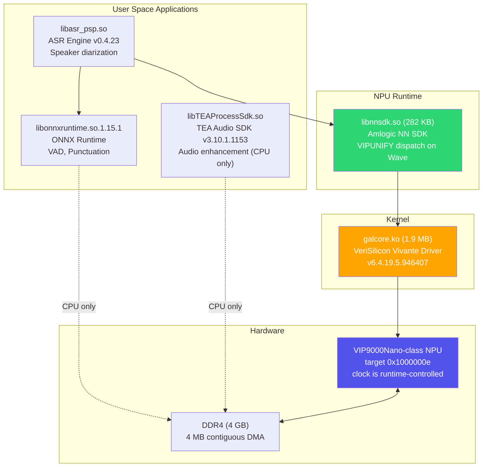
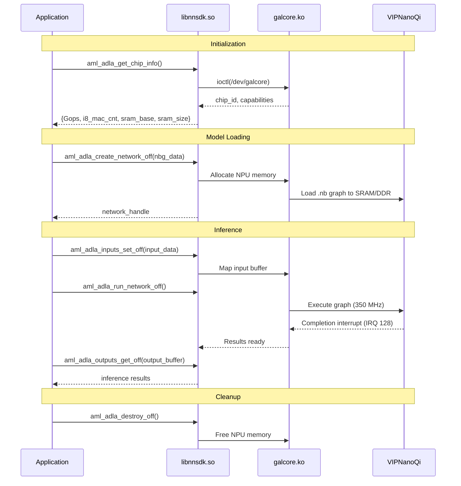
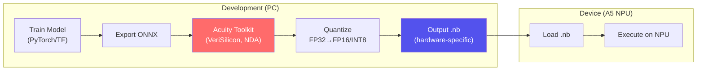
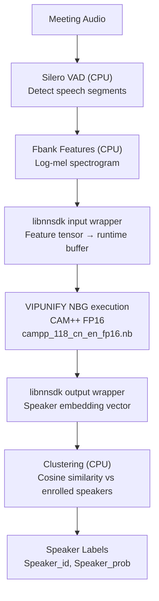
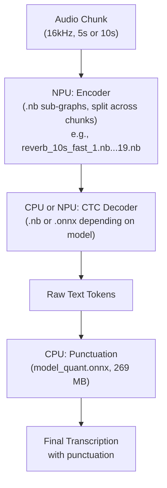
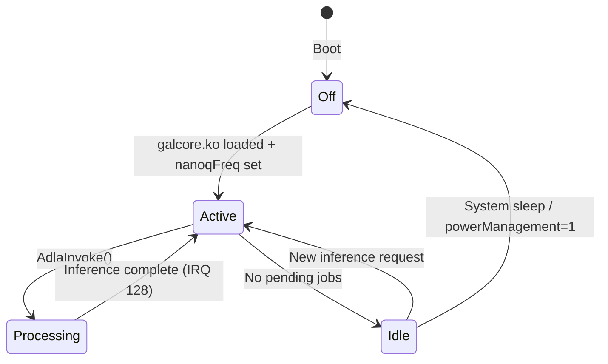

# Insta360 Wave — NPU (Neural Processing Unit) Deep Dive

The Insta360 Wave uses an **Amlogic A5 SoC** with an integrated
VeriSilicon VIP-class NPU. This report mixes live observations, firmware
static analysis, and some early interpretations. The evidence-led,
up-to-date status is maintained in
[`docs/npu/README.md`](npu/README.md) and
[`waved/docs/COMPUTE_HARDWARE.md`](../waved/docs/COMPUTE_HARDWARE.md);
where an older statement below conflicts, those documents supersede it.

## Learned Noise-Cancellation Result (2026-07-29)

The Wave now has a working learned NPU-assisted noise-cancellation research
PoC. A deterministic 962-parameter spectral-mask model offloads its exact
quantized U8 `[481]` Erf partition to one sealed, Wave-targeted VPMN v2 NBG.
CPU code retains the causal STFT, noise estimator, DeepFilterNet candidate,
causal DFN-or-Erf selector, and synthesis.

The fixed 12-second qualification produced:

- 1,201/1,201 successful NPU partition frames and zero fallback frames;
- 577,681/577,681 returned tensor bytes exact against an independent CPU
  oracle;
- 576,000/576,000 reconstructed floating-point samples exact against the
  CPU reference;
- +4.8443 dB median SI-SDR improvement, +0.01083 median STOI delta, and
  9.8283 dB noise-only attenuation;
- a 10,000-execution follow-up soak with all ten rolling oracle checkpoints,
  canaries, and device-health gates passing.

This qualifies only NBG SHA-256
`96447d6afd63a7c349bbd80f0af99150c89ef24ed7f1ef66ab285075362e6c94`
and its exact tensor contract. It does not qualify arbitrary ONNX, Conv,
MatMul, or the general Acuity compiler. The current integration is
Python/lab plus fixed offline TIM-VX runners; production Rust `NpuInfer` and
full service-level real-time qualification remain incomplete.

See the [`result guide`](npu/models/erf-mask/README.md) and
[`completion audit`](npu/models/erf-mask/completion-audit.md).

## Wave CPU versus NPU Result (2026-07-29)

PoC 13G measured the exact U8 `[481]` Erf partition on both compute engines
of the same Wave. Over 10,000 alternating-order steady-state frames, the
Cortex-A55 lookup averaged 3.303 µs, NPU `Run()` averaged 68.330 µs, and the
complete NPU copy/run/read boundary averaged 86.338 µs. The CPU was
20.686 times faster than NPU `Run()` and 26.137 times faster than NPU total
for this tiny operation.

All 10,101 paired outputs matched byte-for-byte and both paths remained well
inside a 10 ms audio hop. This result means that offloading only Erf is not a
performance optimization. It does not predict larger affine or
convolutional partitions, which may amortize fixed NPU submission costs.
See the
[`PoC 13G notebook`](npu/lab-notebook/2026-07-29-poc13g-wave-cpu-vs-npu.md)
and
[`machine-readable result`](npu/performance/erf-wave-cpu-vs-npu.json).

## Affine Serializer Expansion Result (2026-07-29)

PoC 14A froze a larger learned partition that moves the 481-bin affine
transform next to Erf. The deterministic package and independent CPU oracle
passed all held-out noise-suppression gates.

The exact Wave producer did not accept that deployment contract. Its
elementwise checker rejected the first `MULTIPLY` input pair:

```text
ASYM UINT8, SYMM PC INT8
```

The pinned TIM-VX source confirms that Multiply delegates to ADD's finite
59-pair registry and that the registry contains no per-channel pair. No NBG
was emitted, no graph ran, device health remained unchanged, and the
remaining coefficient-only candidates were correctly skipped as
known-equivalent retries. Consequently coefficient packing, semantic affine
emission, and Conv expansion remain blocked.

See the
[`PoC 14A host notebook`](npu/lab-notebook/2026-07-29-poc14a-affine-host.md),
[`PoC 14B negative notebook`](npu/lab-notebook/2026-07-29-poc14b-affine-compiler-negative.md),
and
[`machine-readable compiler profile`](npu/profile/affine-elementwise-compiler-profile.json).

## Custom NBG Update (2026-07-28)

Code we control now does more than run a stock model:

- the exact Wave stack generated an untouched VPMN v2 Erf NBG for target
  `0x1000000e`;
- the 5,840-byte artifact has SHA-256
  `6b2ac998909fecfdf8243e0b1e2b283e5abb485d09d579ae818fbc59824de3ee`;
- strict parsing found one U8 `[4]` input/output, one operation/layer/core,
  43,520 bytes of serialized VIP SRAM requirement, and 3/3 valid stored
  checksums;
- two one-shot runs returned `[0,0,0,0] -> [0,0,0,0]` and
  `[0,1,2,255] -> [0,1,1,1]` with unchanged device health.

This is a narrow custom-model pass. General built-in Add, MatrixMul, and
Conv2d export failed. The tested MatrixMul and Conv2d graphs also failed
ordinary graph verification before inference.

The live dispatch recovered from `libnnsdk.so` is
`/dev/galcore -> VIPUNIFY`; ADLA is another supported backend, not the
active Wave path. The live PoC boot reported `nanoqFreq=838860800`. An older
350 MHz startup assignment and `devCoreCounts=16,0` are configuration
evidence, not proof of the current clock or 16 physical NPU cores.

## Compiler/Profile Acquisition Update (2026-07-28)

PoC 9D acquired and hash-pinned the Radxa-linked Allwinner
`ubuntu-npu:v2.0.10.2` image without loading or running it. Static inspection
recovered the vendor-authored
`VIP9000NANOS_PID0X1000000E.config`, which exactly matches the five-word Wave
database identity from PoC 9A, and byte-locked a real no-kernel
`VIV_GPU_FILE` parser.

This still does not unlock graph compilation. The two genuine
`VIV_GPU_FILE` consumers are standalone GLSL/OpenCL shader compilers at
`6.4.18:967862`; they do not emit graph NBG. Acuity 6.30.22's NBG wrapper
uses `VSIMULATOR_CONFIG` with an embedded `6.4.6:769531` simulator SDK. The
current no-kernel TIM-VX gate requires SDK `>=6.4.22`, and the native
`gen_nbg` input/output ownership ABI remains unproven.

The fixed Conv compile therefore remains blocked with zero compiler,
container, and device calls. The exact missing package is now scoped as an
x86-64 Vivante no-kernel SDK `>=6.4.22` with ovxlib `>=1.2.26`, direct
OpenVX/ovxlib NBG use of `VIV_GPU_FILE`, and complete dependencies, licence,
headers, versions, and I/O contract. See the
[`PoC 9D notebook`](npu/lab-notebook/2026-07-28-poc9d-compiler-acquisition-static-qualification.md).

## ONNX and CPU Fallback Update (2026-07-28)

PoC 9E/9F now provides a host-side general ONNX auditor and deterministic
ONNX Runtime CPU oracle. It recursively bounds control-flow subgraphs,
computes executable graph signatures, explains every placement decision, and
implements explicit `audit`, `cpu`, `hybrid`, and `strict` modes.

This is not an NPU unlock. The policy is hash-bound to the unqualified
compiler profile; PoC 9D's exact vendor config does not change that
qualification. The policy contains zero approved NPU signatures. Current
hybrid mode therefore records zero NPU attempts and one CPU-only session;
strict mode refuses before session construction.

A fixed Conv/Sigmoid spectral-mask control produced byte-identical CPU and
hybrid outputs. The repository Silero VAD model passed a non-executing audit
with 51 graphs and 689 total nodes, all behind one CPU partition. See
[`docs/npu/onnx/README.md`](npu/onnx/README.md).

## Serializer Recovery Update (2026-07-29)

The serializer-first route now has two additional bounded results.

PoC 12B captured exactly three compile-only stock-serializer outputs for a
constant-input U8 Erf graph. A1 and A2 used `[0,1,2,3]` and are
byte-identical; B used `[0,1,2,4]`. No NBG was loaded or executed, and the
device returned to its exact baseline. The original finite-registry analysis
is sealed as `multi-region-unresolved`.

PoC 12C is a separate host-only qualification. Static analysis of the exact
Wave `libOpenVX.so` save routine plus the controlled bytes and full v2
corpus proves:

- header `crc_sum` is reflected IEEE CRC-32 initialized to zero and updated
  over section payloads in directory order;
- section-40 checksum-value words are zero during that calculation and
  written afterward;
- section 20 is the dynamic-I/O data region and section 26 is its repeated
  little-endian `(offset, size)` table;
- all 138 v2 header CRCs match;
- all 8,939 entries across 111 paired graphs are positive, 64-byte aligned,
  ordered, non-overlapping, and in bounds;
- replacing the one controlled byte in an in-memory A copy and recomputing
  the header checksum reproduces B exactly.

This removes two serializer unknowns but does not recover coefficient
packing, operation encoding, arbitrary safe mutation, or general
ONNX-to-NBG compilation. The general PoC 9 ONNX policy therefore remains
CPU-only; PoC 13 uses a separate exact-hash approval for one sealed Erf
partition.
See the
[`PoC 12B notebook`](npu/lab-notebook/2026-07-29-poc12b-erf-constant-differential.md),
[`PoC 12C notebook`](npu/lab-notebook/2026-07-29-poc12c-dyna-io-crc-profile.md),
and
[`machine evidence`](npu/format/dyna-io-crc-profile.json).

## Live Custom-Process Inference Result (2026-07-23)

NPU access from code we control is now proven beyond context creation.
The Rust `waved-npu-probe` loads the device's stock `libnnsdk.so`,
queries NBG tensor metadata, submits an input, runs an existing
Wave-targeted CTC graph, retrieves its output, and destroys the graph.

Three deterministic runs returned the same nonzero 332,800-byte output
(SHA-256
`e621b2134934ab94ab83049b4b56e5bb410831de41d9727aaf95384d413b52d4`)
in 3.501, 2.184, and 2.263 ms. A second complete invocation also passed.
The stock `waved` process and NPU parameters were unchanged.

The original custom Add graph does **not** run because its host simulator
emits product target `0x10000020`; the Wave's graphs target `0x1000000e`.
The later on-device compiler PoCs changed the status:

- Direct NPU inference from our process: **working**.
- Loading a correctly targeted external NBG: **working**.
- Compiling and executing one repository-defined Erf NBG: **working**.
- Compiling arbitrary ONNX models: **blocked by the missing exact compatible
  general compiler/program package**.

The PoC source is under `waved/crates/waved-npu-probe/`; the full
reproduction record is in `waved/docs/COMPUTE_HARDWARE.md`.

---

## 1. NPU Hardware (Verified from Live Device)

### Specifications

| Property | Value | Source |
|---|---|---|
| **SoC** | Amlogic A5 (AV400) | Build paths, board name `AmlSpeaker` |
| **NPU IP** | VeriSilicon VIP class; runtime reports VIP9000Nano-S target `0x1000000e` | DT names plus verbose live runtime |
| **Driver** | `galcore.ko` v6.4.19.5.946407 | `strings galcore.ko` |
| **License** | Dual MIT/GPL | Module description |
| **Device node** | `/dev/galcore` (major 199, minor 0) | `ls -la /dev/galcore` |
| **DT compatible** | `amlogic, galcore` | `/proc/device-tree/galcore/compatible` |
| **Clock** | `838860800` observed during accepted 2026-07-28 PoCs; an older init path writes 350 MHz | live `nanoqFreq` plus static startup script |
| **NN Power Version** | 6 | `/proc/device-tree/galcore/nn_power_version` |
| **Compute cores** | Physical count not established; `devCoreCounts=16,0` is a driver configuration field | parameter plus PoC 5D caveat |
| **NPU memory region** | 2 MB DT region at `0xF7000000`; stock NBGs serialize 256 KiB VIP-SRAM requirement | DT plus strict NBG corpus parser |
| **Register space** | 256 KB at `0xFDB00000` | DT `reg` / `NN_REG` |
| **DMA buffer** | 4 MB contiguous | `contiguousSize` parameter |
| **MMU** | Enabled | `mmu` parameter |
| **INT8 MACs** | Hardware supported | `adla i8 mac_cnt` in libnnsdk |
| **FP16** | Supported (CAM++ runs in FP16) | Model filename `_fp16.nb` |
| **IRQ** | GIC SPI 128, edge-triggered | DT `interrupts` |

### Memory Map (from Device Tree)

```
┌──────────────────────────────────────────────────┐
│  Address Range              │ Size    │ Name     │
├──────────────────────────────────────────────────┤
│  0xFDB00000 - 0xFDB3FFFF   │ 256 KB  │ NN_REG   │  NPU control registers
│  0xF7000000 - 0xF71FFFFF   │ 2 MB    │ NN_SRAM  │  On-chip fast SRAM
│  0xFE00C040                 │ 4 B     │ NN_MEM0  │  Memory control
│  0xFE00C044 (inferred)      │ 4 B     │ NN_MEM1  │  Memory control
│  (DT entry)                 │         │ NN_RESET │  Reset control
│  (DT entry)                 │         │ NN_CLK   │  Clock control
└──────────────────────────────────────────────────┘
```

### Clocks

| Clock | Purpose |
|---|---|
| `cts_vipnanoq_axi_clk_composite` | AXI bus interface clock (memory access) |
| `cts_vipnanoq_core` | Core processing clock — **set to 350 MHz** at boot |

The firmware sets the clock at audio initialization (`Insta360_InitAudio`):
```bash
echo 350000000 > /sys/module/galcore/parameters/nanoqFreq
```

### galcore Driver Parameters (All Values from Live Device)

| Parameter | Value | Description |
|---|---|---|
| `nanoqFreq` | 838860800 | Value pinned by the accepted 2026-07-28 live manifests |
| `enableNN` | 255 | All NN features enabled (bitmask) |
| `devCoreCounts` | 16,0 | Driver configuration; not a proven physical-core count |
| `dev2DCoreCounts` | 4,0 | Driver configuration; not a proven physical 2D-core count |
| `contiguousSize` | 4194304 | 4 MB contiguous DMA buffer |
| `registerMemBase` | 2147483648 | 0x80000000 |
| `registerMemSize` | 131072 | 128 KB |
| `mmu` | 1 | MMU enabled |
| `mmuDynamicMap` | 1 | Dynamic MMU mapping |
| `mmuCmdPool` | 1 | Command pool MMU |
| `mmuPageTablePool` | 1 | Page table pool |
| `powerManagement` | 1 | Power management enabled |
| `recovery` | 1 | Auto-recovery on error |
| `flatMapping` | 1 | Flat memory mapping |
| `allMapInOne` | 1 | Single mapping mode |
| `smallBatch` | 1 | Small batch optimization |
| `compression` | -1 | Auto compression |
| `fastClear` | -1 | Auto fast clear |
| `major` | 199 | Character device major number |
| `debugLevel` | 0 | Debug output disabled |

---

## 2. Software Stack



### What Runs Where

| Component | Runtime | Hardware | Notes |
|---|---|---|---|
| **CAM++ speaker diarization** | libnnsdk (VIPUNIFY) | **NPU** | FP16 NBG |
| **SenseVoice/Zipformer ASR** | libnnsdk (VIPUNIFY) | **NPU** | Compiled to `.nb` (up to 50 MB per sub-graph) |
| **Reverb-ASR English** | libnnsdk (VIPUNIFY) | **NPU** | 38 `.nb` files, 177 MB encoder |
| **German/French/Japanese ASR** | libnnsdk (VIPUNIFY) | **NPU** | Split into 6/12-chunk variants |
| **CTC decoder** | ONNX Runtime or ADLA | **Mixed** | Some `.nb` (NPU), some `.onnx` (CPU) |
| **Silero VAD** | ONNX Runtime | **CPU** | 2.2 MB ONNX; no compiler-qualified NPU partition |
| **Punctuation (269 MB)** | ONNX Runtime | **CPU** | ONNX only, not compiled for NPU |
| **RAFA noise suppression** | TEA SDK | **CPU** | TNNE format, ARM NEON SIMD |
| **NNEC echo cancellation** | TEA SDK | **CPU** | TNNE format, ARM NEON SIMD |
| **Beamforming models** | TEA SDK | **CPU** | Binary coefficients, ARM NEON |

**Key insight from model extraction:** Almost ALL ASR models are in `.nb` format (NPU-compiled). The device runs ASR inference primarily on the NPU, not the CPU. Only VAD (too small) and punctuation (too large / not compiled) run on CPU.

---

## 3. Multi-Backend Amlogic NN SDK API

The binary exposes ADLA-named functions and supports ADLA, VIPLITE, and
VIPUNIFY backends. Static dispatch recovery and the live device node show
that this Wave uses VIPUNIFY through `/dev/galcore`. The ADLA names below are
an available API family, not proof that the active hardware is ADLA.

The ADLA API is exposed through `libnnsdk.so`. All function names extracted from the live device binary.

### Core API Functions



### Complete Function List (from libnnsdk.so)

**Chip Info:**
```c
NNsdk_get_chip_info()          // Get NPU hardware capabilities
fetch_adla_hw_info()           // Fetch ADLA hardware info
aml_adla_get_chip_info()       // Get chip ID and features
```

**Network Management (offline = pre-compiled .nb):**
```c
aml_adla_create_network_off()  // Load pre-compiled .nb model
aml_adla_create_network_on()   // Compile and load at runtime
aml_adla_destroy_off()         // Unload offline network
aml_adla_destroy()             // Unload runtime network
```

**Input/Output:**
```c
aml_adla_inputs_set_off()      // Set input tensor (offline)
aml_adla_inputs_set()          // Set input tensor (runtime)
aml_adla_outputs_get_off()     // Get output tensor (offline)
aml_adla_outputs_get()         // Get output tensor (runtime)
aml_adla_outputs_set_off()     // Set output buffer (offline)
aml_adla_outputs_set()         // Set output buffer (runtime)
```

**Execution:**
```c
aml_adla_run_network_off()     // Run inference (offline model)
aml_adla_run_network()         // Run inference (runtime model)
```

**Advanced:**
```c
aml_adla_updateKvcacheinfo()   // Update KV-cache for transformers
aml_adla_setKvcacheopt()       // Set KV-cache optimization
aml_adla_disableProfile()      // Disable profiling
adla_compiler_func()           // Runtime compilation
sdk_version()                  // Get SDK version string
```

### Higher-Level ADLA API (from decompiled code)

These are the C++ wrapper functions (see also `docs/REPORT_NPU.md` for the full list):

```c
AdlaCreateContext()             // Create execution context
AdlaDestroyContext()            // Destroy context
AdlaAllocateMemory()            // Allocate NPU-accessible DMA memory
AdlaAllocateMemoryExt()         // Extended allocation with flags
AdlaFreeMemory()                // Free NPU memory
AdlaSetInput() / AdlaBindInput()  // Bind input tensor
AdlaSetOutput() / AdlaBindOutput() // Bind output tensor
AdlaInvoke()                    // Synchronous inference
AdlaInvokeNoWait()              // Async inference
AdlaWait() / AdlaWaitWithId()   // Wait for async completion
AdlaGetNumInputs/Outputs()      // Query tensor count
AdlaGetInputDesc/OutputDesc()   // Query tensor shape/type
AdlaSetWorkingFrequency()       // Set NPU clock
AdlaGetWorkingFrequency()       // Get NPU clock
AdlaEnableProfiling()           // Performance profiling
AdlaGetProfilingData()          // Get latency/throughput
```

### NPU Core Types

The libnnsdk.so supports multiple core types (from strings):

| Core Type | Description | Used in Wave? |
|---|---|---|
| ADLA Core | Amlogic Deep Learning Accelerator | Supported by binary; not active path observed |
| VIPLITE Core | VeriSilicon VIPLite | Fallback |
| **VIPUNIFY Core** | VeriSilicon VIPUnify | **Active: `/dev/galcore` on this Wave** |

The runtime detects the available device node and dispatches accordingly.
PoC 1 recovered `/dev/galcore -> VIPUNIFY` for this Wave.

### Supported Chip Variants (in libnnsdk.so)

| PID | Chip | Used? |
|---|---|---|
| `VIPNANOQI_PID0X1E` | Unknown | |
| `VIPNANOQI_PID0X7D` | S5 | |
| `VIPNANOQI_PID0X88` | C3 | |
| `VIPNANOQI_PID0X99` | Unknown | |
| `VIPNANOQI_PID0XA1` | T3X | |
| `VIPNANOQI_PID0XB9` | T7C | |
| `VIPNANOQI_PID0XBE` | S6 | |
| `VIPNANOQI_PID0XE8` | A5 (likely) | **Yes** |

---

## 4. NBG Model Format (Network Binary Graph)

### What Is NBG?

NBG is VeriSilicon's **pre-compiled** model format. An ONNX or TensorFlow model is compiled ahead of time using VeriSilicon's **Acuity Toolkit** into a hardware-specific binary graph that maps directly to NPU operations.

### Compilation Pipeline



### What's Inside an NBG File

A `.nb` file contains:
1. **Graph topology** — Layer connections, operation types
2. **Weight data** — Quantized weights mapped to NPU memory layout
3. **Execution plan** — Which NPU cores execute which layers
4. **Memory plan** — SRAM allocation for activations between layers
5. **DMA schedule** — When to transfer data between DDR and SRAM
6. **Tiling info** — How large tensors are split across compute cores

**NBG files are NOT portable** — they are compiled for a specific NPU variant (VIPNanoQi on Amlogic A5). Running them on a different chip (even another Amlogic with VIPNanoQi) may fail if the core configuration differs.

### Model Splitting Strategy

Large models are split into multiple `.nb` files for several reasons:

1. **SRAM limit** — The NPU has 2 MB SRAM. Large models can't fit entirely.
2. **Pipelining** — Different sub-graphs execute in sequence, reusing SRAM
3. **Flexibility** — Different chunk lengths for streaming vs. offline

Example: SenseVoice Chinese offline model:
```
svs6_sp_1.nb  through  svs6_sp_15.nb    (15 files, "6" = 6-chunk mode)
svs12_sp_1.nb through  svs12_sp_15.nb   (15 files, "12" = 12-chunk mode)
```

Example: English Reverb-ASR offline:
```
reverb_5s_split_fast_1.nb  through  reverb_5s_split_fast_19.nb   (5-second chunks)
reverb_10s_fast_1.nb       through  reverb_10s_fast_19.nb        (10-second chunks)
```

---

## 5. How the NPU Is Used in Practice

### Speaker Diarization (CAM++)

The primary documented NPU workload. CAM++ extracts speaker embeddings from audio segments.



**Model:** `campp_118_cn_en_fp16.nb` (17 MB, FP16 quantized)
**Input:** Audio features (Fbank) per speech segment
**Output:** Fixed-length speaker embedding vector
**Latency:** Not measured by the accepted PoCs for this model.

### ASR Inference (All Languages)

From the extracted models, we now know ALL ASR encoders run on NPU:



The encoder (most compute-intensive part) always runs on NPU. The CTC decoder runs on either NPU (`.nb`) or CPU (`.onnx`). Punctuation always runs on CPU.

---

## 6. NPU Performance Characteristics

### Measured control timing

No defensible peak-TOPS, physical-core, or SRAM-bandwidth measurement has
been completed. Do not derive them from driver configuration fields or model
size.

The accepted same-device Erf benchmark measured one tiny U8 `[481]`
partition:

```text
Cortex-A55 LUT mean:  3.303 us
NPU Run mean:        68.330 us
NPU total mean:      86.338 us
NPU Run / CPU:       20.686x
NPU total / CPU:     26.137x
```

This is a real paired benchmark, but its scope is deliberately narrow. The
CPU path is a 256-byte lookup table, while the NPU pays graph-submission and
tensor-copy overhead.

The accepted stock CTC control executed three iterations in each of two
fresh processes:

```text
8.198, 2.241, 2.290 ms
3.539, 2.155, 2.160 ms
```

The six-sample median is 2.266 ms. This is descriptive, not a benchmark:
input was zero-filled, the graph is one CTC component, the sample is tiny,
and no thermal/scheduler controls were imposed.

Future performance work may use recovered profiling APIs only after their
exact active-backend ABI and safety are reviewed:

```bash
# On the device via ADB:
# The ADLA API supports profiling:
# AdlaEnableProfiling() → run inference → AdlaGetProfilingData()
# Currently no profiling binary exists on the device
```

---

## 7. Power Management

### Dynamic Power States



The `powerManagement` parameter is enabled (`1`), meaning the NPU can be power-gated when idle. The firmware sets a fixed 350 MHz clock and doesn't dynamically scale — the NPU runs at full speed whenever active.

### SRAM Usage

The 2 MB on-chip SRAM at `0xF7000000` is the critical performance resource:
- **Fast access** — single-cycle latency, no DDR contention
- **Layer activations** — intermediate results stored here between layers
- **Weight cache** — frequently used weights kept in SRAM
- **Spill to DDR** — when activations exceed 2 MB, they go to the 4 MB contiguous DMA buffer in DDR (slower)

This is why models are split into sub-graphs — each sub-graph is sized to fit its activations within the 2 MB SRAM.

---

## 8. Sysfs Interface Reference

### Reading NPU Status

```bash
# Via ADB shell:

# Current clock frequency
cat /sys/module/galcore/parameters/nanoqFreq
# → 350000000

# Set clock frequency
echo 500000000 > /sys/module/galcore/parameters/nanoqFreq  # Overclock (risky!)

# Check if NN is enabled
cat /sys/module/galcore/parameters/enableNN
# → 255 (all features)

# Number of compute cores
cat /sys/module/galcore/parameters/devCoreCounts
# → 16,0

# Contiguous DMA memory
cat /sys/module/galcore/parameters/contiguousSize
# → 4194304 (4 MB)

# Debug level (increase for NPU debugging)
echo 5 > /sys/module/galcore/parameters/debugLevel

# Check stuck/error state
cat /sys/module/galcore/parameters/stuckDump
# → 0 (no stuck state)
```

### Device Tree (DT) Properties

```bash
# Compatible string
cat /proc/device-tree/galcore/compatible
# → amlogic, galcore

# Status
cat /proc/device-tree/galcore/status
# → okay

# NN power version
xxd /proc/device-tree/galcore/nn_power_version
# → 00000006 (version 6)

# Register names
cat /proc/device-tree/galcore/reg-names
# → NN_REG, NN_SRAM, NN_MEM0, NN_MEM1, NN_RESET, NN_CLK

# Clock names
cat /proc/device-tree/galcore/clock-names
# → cts_vipnanoq_axi_clk_composite, cts_vipnanoq_core
```

---

## 9. Recreating the NPU Pipeline

### If You Have the Same Hardware (Amlogic A5)

Do not copy an approximate `ctypes` declaration for this binary. PoC 1 found
that the Wave's private `aml_module_*` create/input/output records are not
layout-compatible with the nearby public Amlogic header, and some wrapper
return values hide backend failures.

Use the compile-time-checked Rust layouts in
`waved/crates/waved-npu-probe/` for the stock control, or the fixed TIM-VX
NBG runners under `waved/tools/npu-compiler/` for the generated Erf control.
Both paths validate tensor metadata, byte lengths, output content, cleanup,
timeouts, and exact artifact hashes.

### If You Have Different Hardware

The `.nb` files are NOT portable. To run these models on other hardware:

1. **Get the original ONNX models** — Most are available open-source (see below)
2. **Run with ONNX Runtime** on CPU/GPU
3. **Or recompile** for your NPU using the appropriate toolkit

### Open Source Model Equivalents

| Model on Device | Open Source | Link |
|---|---|---|
| SenseVoice (offline Chinese) | SenseVoice | https://github.com/FunAudioLLM/SenseVoice |
| Zipformer (online Chinese) | Sherpa-ONNX | https://github.com/k2-fsa/sherpa-onnx |
| Reverb-ASR (English) | WeNet | https://github.com/wenet-io/wenet |
| CAM++ (diarization) | 3D-Speaker | https://github.com/modelscope/3D-Speaker |
| Silero VAD v5 | Silero VAD | https://github.com/snakers4/silero-vad |
| CT-Transformer (punctuation) | FunASR | https://github.com/modelscope/FunASR |

---

## 10. Summary

The Insta360 Wave's NPU is a VeriSilicon VIP9000Nano-class accelerator
integrated into the Amlogic A5 SoC. Durable verified facts include:

- exact graph target/customer ID `0x1000000e`;
- chip model/revision `0x9000/0x9002`;
- galcore `6.4.19.5.946407` at `/dev/galcore` `199:0`;
- a 2 MB device-tree NPU memory region and a 4 MB contiguous driver buffer;
- FP16 and integer graph evidence;
- `nanoqFreq=838860800` during the accepted 2026-07-28 PoCs;
- exact v2 header-CRC producer order validated on 138/138 graphs;
- decoded section-20/26 dynamic-I/O geometry validated over 8,939 entries.

The `devCoreCounts=16,0` setting and 2 MB DT region must not be promoted to
precise physical-core/SRAM-microarchitecture claims without further
measurement.

It runs **virtually all ASR inference** (not just speaker diarization as initially assumed from the decompiled code). The 4.1 GB model partition contains **173 files**, mostly in `.nb` format pre-compiled for this specific NPU. Only the VAD (2.2 MB ONNX) and punctuation models (535 MB ONNX) run on the CPU.

The active stock path is `libnnsdk.so` → VIPUNIFY/OpenVX/GAL →
`galcore.ko` → hardware. Repository-controlled code has executed both a
stock NBG and one generated Erf NBG. Useful audio-model portability is still
blocked by the compatible general compiler, coefficient/command emitters,
and operation surface. The recovered CRC and dynamic-I/O table do not by
themselves permit arbitrary model emission.

---

*Original inventory captured from live-device and extracted-firmware evidence
in March 2026; custom compiler/runtime conclusions updated from bounded PoCs
through July 29, 2026.*
