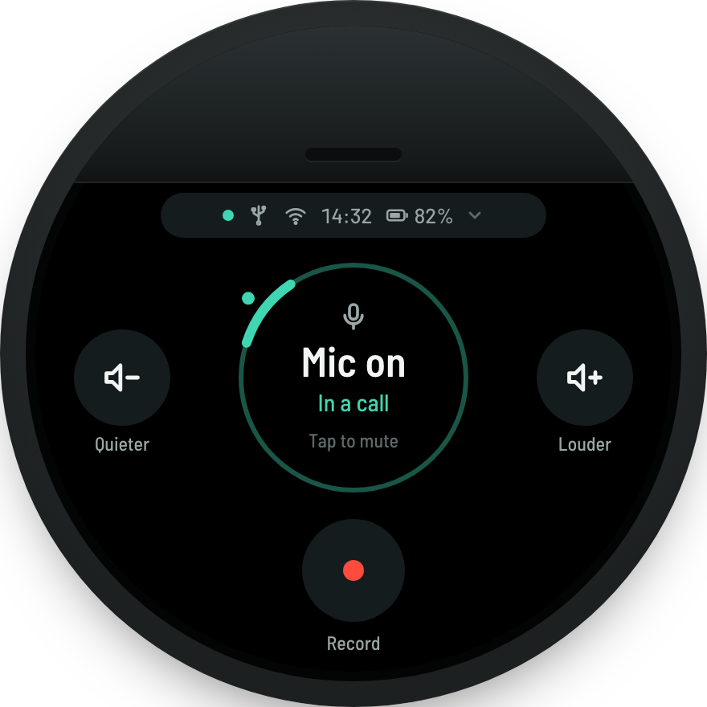
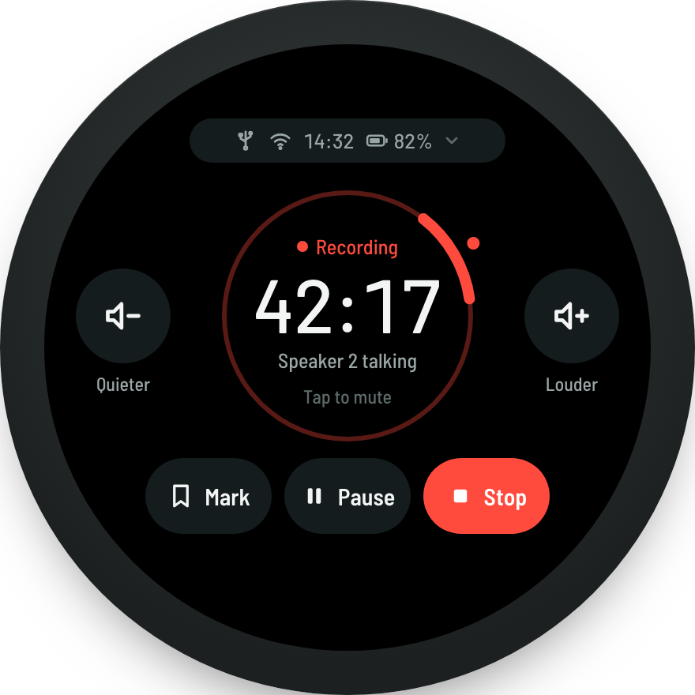
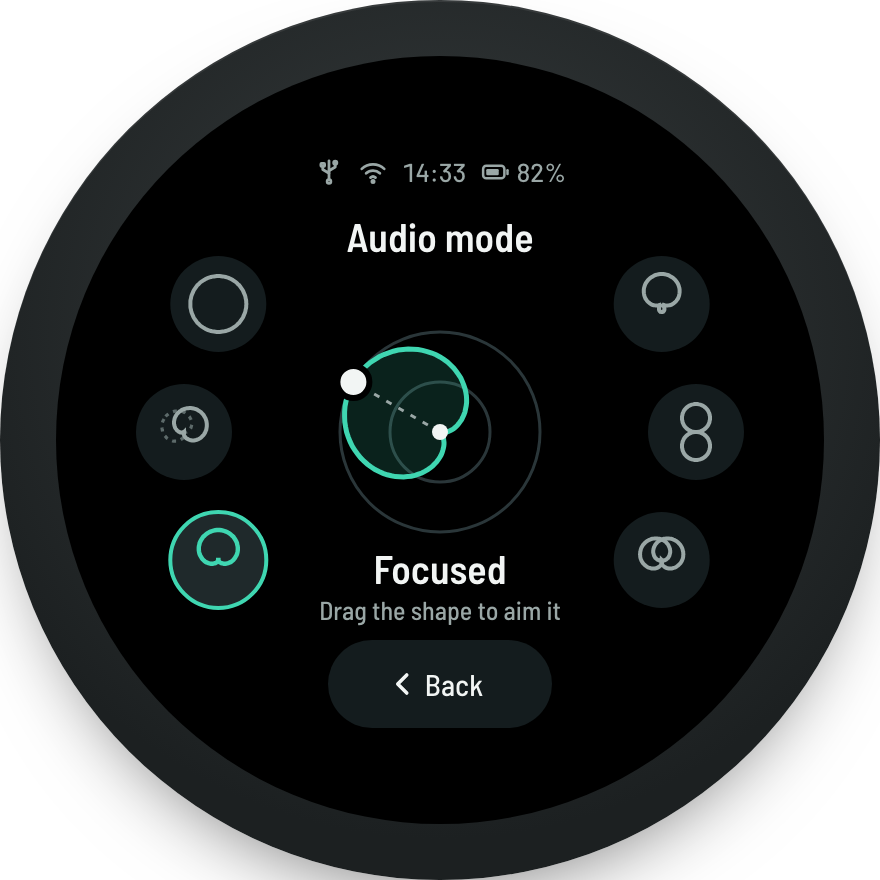
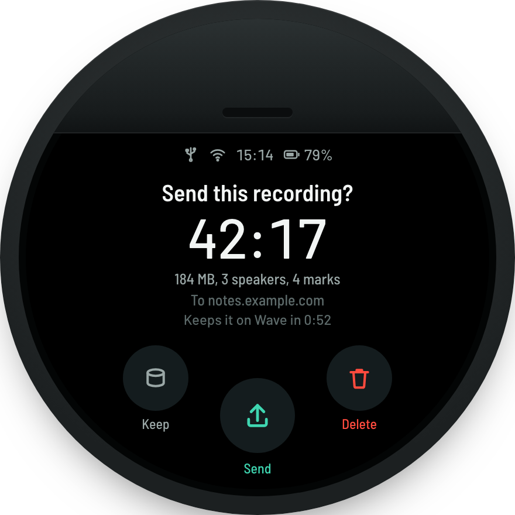
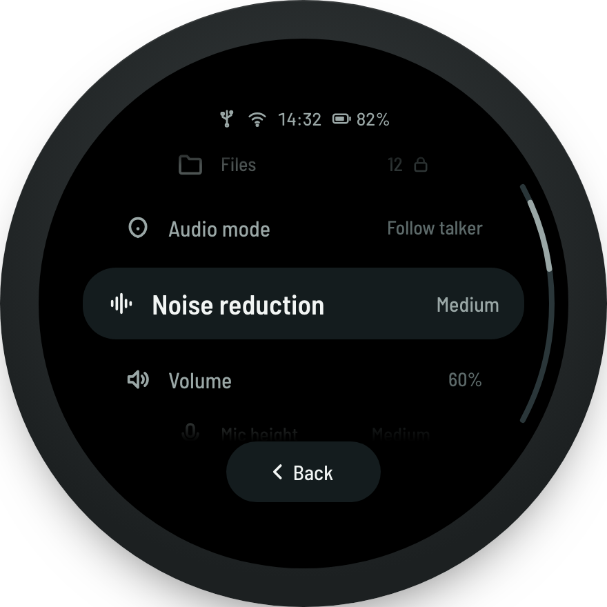
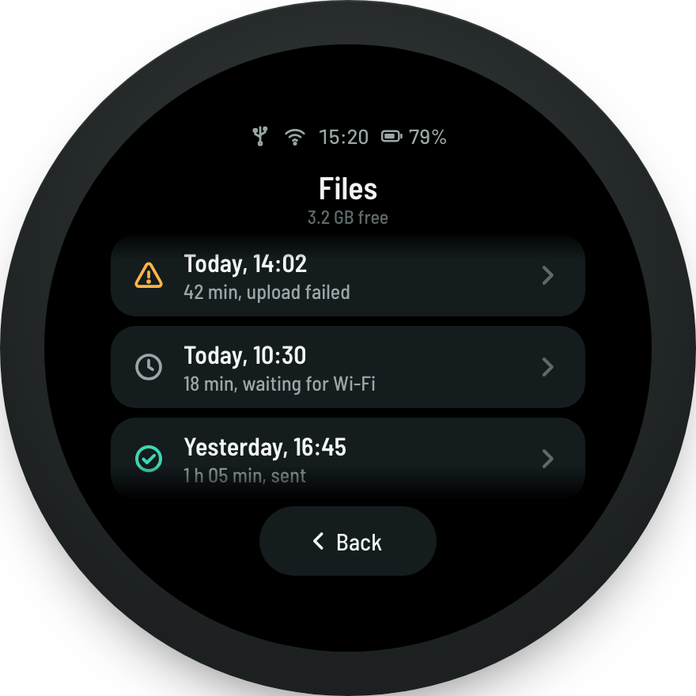

# Wave display redesign, revision 2

Open [`index.html`](index.html) in a browser for the full spec. It shows every screen at 1:1
framebuffer scale, has a "Show layout zones" overlay, and lists the open decisions. PNG
renders are in [`png/`](png/).

Every mockup is positioned in **real framebuffer pixels**: 400 × 304, LVGL logical
coordinates are what the user sees (see `waved/docs/ui/COORDINATE_SYSTEM.md`). The
`left/top/width/height` values in `index.html` can be used directly in `lv_obj_set_pos` /
`lv_obj_set_size`.

| | | |
|---|---|---|
|  |  |  |
| Home: tap the dial to mute | Recording: same layout, new bottom row | Audio mode: six modes around a live preview |
|  |  |  |
| After stop: Send, Keep, Delete | Menu: opens from the status pill | Files: attention first |

## What changed since revision 1

| Change | Why |
|---|---|
| Tapping the dial mutes (Home, Recording) | Mute is the most frequent action in a meeting, so it gets the biggest target, and the ring turning red is visible from every seat. |
| Quieter / Louder on the sides of Home and Recording | Volume becomes one tap instead of a trip to another screen. The dial shows the level while it changes. |
| Menu opens from the status pill at the top | The old "Menu" handle sat 4 px under Record, where a slip started a recording. |
| Mark, Pause, Stop in one row; Stop needs a 1 s hold | Stopping can't be undone. A short tap explains the hold instead of doing nothing. |
| "Send this recording?" with a 60 s auto-Keep | The old screen waited forever. Keep is the safe default: nothing leaves the device and nothing is deleted. |
| Audio modes as a radial picker with drag-to-aim | All options are visible at once. Directional modes get a direction you choose, which today's code can't express from the UI. |
| One Back button, 112 × 44 px at (144, 252) | Revision 1 still had two Back styles and a 36 px target. |
| New screens | Start-up, first start, resting screen, recording muted, holding Stop, Mic height, Bluetooth, After a recording, Display, Date and time, PIN. |
| PIN for Files and admin settings | Files, Wi-Fi, Bluetooth, Uploads and System ask for the PIN. Mute, volume, Record, audio mode and noise reduction never do. |

## Layout system

The panel is a 380 px circle (r ≈ 190 at (200,152)) cropped by the 400 × 304 framebuffer.
It is 228 px wide at y = 0 and 380 px wide at y = 152.

| Zone | y range | Contents |
|---|---|---|
| Status | 0–36 | Status cluster or status pill (connection, time, battery). Messages replace it for a few seconds. |
| Title | 38–62 | Sub-screen title, 20 px semibold. Not used on Home and Recording. |
| Core | 64–248 | Screen content. On Home and Recording: the dial, centre (200,132), r = 78. |
| Sides | centre y = 132 | Secondary actions: 60 px circles centred at x = 58 and x = 342, with a 12 px label below. |
| Base | 250–304 | One primary action, a row of two or three buttons, or Back. |

Rules:

1. **Tap limit r = 182 px.** No tappable pixel is farther than 182 px from (200,152).
2. **Targets ≥ 44 px, main actions ≥ 50 px.** Short bars and icons get invisible full-size hit areas.
3. **Same place, same job.** Quieter left, Louder right, mute in the dial, recording controls
   at the bottom, menu at the top, Back bottom centre.
4. **Messages replace the status pill.** One line, ≤ 230 px, never clickable, never over a button.
5. **Colour carries meaning only:**
   - teal `#3fd6b1`: live, selected or healthy
   - red `#ff4b3e`: recording, muted or destructive
   - amber `#ffb547`: paused or needs attention
   - everything else is grey on `#000`
6. **Undo-proof actions are isolated.** Stop needs a hold. Delete, Factory reset, Power off
   and Stop USB storage go through the confirmation dialog.

## Interaction model

| Input | Where | Result |
|---|---|---|
| Tap the dial | Home, Recording | Toggle microphone mute |
| Tap the status pill, or swipe down from the top edge | Home, Recording | Open Menu |
| Tap Back, or swipe right | Any sub-screen | Go back one level |
| Tap Quieter / Louder | Home, Recording | Speaker −/+ 10 %, dial shows the gauge for 1.5 s |
| Hold Quieter / Louder | Home, Recording | Repeat the step every 300 ms |
| Short tap on Stop | Recording | Message "Hold Stop to end the recording" |
| Hold Stop for 1 s | Recording | Stop. Releasing early cancels. |
| Drag the pattern | Audio mode (Focused, Narrow, Two sides) | Aim the beam (`SetDoaOverride`) |
| First tap on the resting screen | Resting | Wake only, nothing else happens |
| Power key, short press | Anywhere | Screen to resting/off, or wake |
| Power key, hold 2 s | Anywhere | Power-off confirmation |

## Timings

| What | Value |
|---|---|
| Success and info messages | 2 s |
| Warning and error messages | 4 s |
| Volume gauge in the dial | 1.5 s after the last step |
| Hold to stop | 1 s |
| Resting screen ("Dim after") | 2 min without a touch, configurable |
| Screen off | 10 min without a touch, unless recording or in a call (then resting only) |
| "Send this recording?" auto-Keep | 60 s |
| Bluetooth pairing window | 2 min |

## Dial states

| State | Ring | Centre | Second line | Hint |
|---|---|---|---|---|
| Nothing connected | grey `#2a3639` | Mic on | Not connected | Tap to mute |
| Connected, mic not in use | grey | Mic on | Connected by USB / Bluetooth: *name* | Tap to mute |
| Computer is using the mic (`upstream_active`) | teal 40 % + talker arc | Mic on | Computer is using the mic | Tap to mute |
| In a call (HID off-hook) | teal 40 % + talker arc | Mic on | In a call | Tap to mute |
| Muted | solid red | Muted (mic-off icon) | Call can't hear you / Mic is off | Tap to unmute |
| Recording | red 35 % + red talker arc | timer | Speaker *n* talking | Tap to mute |
| Recording, muted | solid red | timer | Muted, not recorded | Tap to unmute |
| Paused | dashed amber | timer | Not recording | Tap to mute |
| Volume changing | gauge −135°…135°, teal fill | *n* % | — | — |

The talker arc is 44° wide and centred on the smoothed direction-of-arrival azimuth. It is only
drawn while voice activity is detected and audio is going somewhere (call, computer or recording).

## Tokens

```rust
// theme.rs — 0xRRGGBB, converted to RGB565 by rgb()
pub const CLR_BG: u32       = 0x000000;
pub const CLR_SURFACE: u32  = 0x141c1e; // buttons, focused rows, status pill
pub const CLR_RAISED: u32   = 0x1f292b; // messages, pressed state
pub const CLR_LINE: u32     = 0x2a3639; // idle ring, arc tracks, outlines
pub const CLR_TEXT: u32     = 0xf2f5f4;
pub const CLR_TEXT_2: u32   = 0x9aa7a6;
pub const CLR_TEXT_3: u32   = 0x5d6a6a;
pub const CLR_LIVE: u32     = 0x3fd6b1;
pub const CLR_ON_LIVE: u32  = 0x00140f; // text on teal fills
pub const CLR_REC: u32      = 0xff4b3e;
pub const CLR_WARN: u32     = 0xffb547;
```

These replace today's four greens and three reds. Also set `LV_THEME_DEFAULT_DARK 1`, or style
every object explicitly. Today the default light theme leaks white discs and 35 px padding
into unstyled widgets.

### Type

| Role | Font | Size / line height | Use |
|---|---|---|---|
| big | Barlow Medium, tabular figures | 48 / 52 | timer, clock, volume, update % |
| dial | Barlow Semi Condensed SemiBold | 26 / 30 | dial state, dialog titles |
| title | Barlow Semi Condensed SemiBold | 20 / 24 | screen titles, focused list row, mode names |
| body | Barlow Semi Condensed Medium | 15 / 18 | buttons, primary lines |
| small | Barlow Semi Condensed Medium | 13 / 16 | descriptions, status, messages |
| micro | Barlow Semi Condensed Medium | 12 / 14 | side-button labels, hints |

Both families are OFL. Generate them with `lv_font_conv` at 4 bpp:

```bash
npx lv_font_conv --font BarlowSemiCondensed-Medium.ttf --size 15 --bpp 4 --format lvgl \
  -r 0x20-0x7E,0xA0-0xFF,0x2013,0x2014,0x2018,0x2019,0x201C,0x201D,0x2022,0x2026,0x2212 \
  -o font_body_15.c
```

The range covers `…`, `·`, curly quotes, `−` and Latin-1 accents. The current Montserrat build
has none of them.

### Icons

All icons come from one subset of the Tabler Icons webfont (MIT, outline style with 2 px
strokes), so they match the line icons in `index.html`. `crates/waved-ui/fonts/icons.py` lists
the 48 icons. They are rendered at 16, 20, 26 and 44 px. No PNGs need to be deployed, which
is the reason the Save/Send/Discard buttons render blank today.

## Components

| Component | Size and position | LVGL |
|---|---|---|
| Status cluster | 200 × 20 at (100,8) | top layer, not clickable |
| Status pill (Home, Recording) | 200 × 28 at (100,7), radius 14 | clickable, opens Menu |
| Message | h 28, max w 230, centred at y 7, radius 14 | top layer, not clickable, hides the status for its duration |
| Dial | r 78 at (200,132), stroke 3; talker arc stroke 7 | `lv_arc` × 2 plus a clickable round `lv_obj` (r 82) for mute |
| Side button | 60 × 60 at (28,102) / (312,102) | `lv_button`, hold-repeat 300 ms |
| Primary | 184 × 56 at (108,216), radius 28; optional second line 11 px | `lv_button` |
| Button pair | 108 × 48 at (86,222) and (206,222) | `lv_button` × 2 |
| Button row of three | 80 × 48 at (72,222), (160,222), (248,222) | `lv_button` × 3 |
| Back | 112 × 44 at (144,252), radius 22 | `lv_button`, calls `nav::back()` |
| Rotary list | viewport y 34–252; rows 34 / 46 / 52 px; focused row 320 wide | flex column, `LV_EVENT_SCROLL` scaling (`lv_example_scroll_6`), bottom fade |
| Arc scrollbar | r 180, 62°–118° | `lv_arc`, value tied to scroll position |
| Radio list | rows 296 × 52 at x 52 | `lv_obj` rows with a radio indicator |
| Value row | h 38–44, radius 20, label left, value right, chevron | `lv_button` |
| Switch | 44 × 26 | `lv_switch` |
| Value arc | r 72–92, 270° sweep, stroke 8, knob 22 | `lv_arc` (Volume, Mic level, Display) |
| Radial mode picker | six 48 px buttons on r 128 around (200,148); preview r 50 | `lv_button` × 6 + `lv_canvas` |
| Confirmation | icon 56 px, title 26 px, body 13 px, button pair | modal screen |
| PIN keypad | 3 × 4 keys of 64 × 48 at x 96/168/240, y 80/134/188/242 | modal screen, no status |

## Screens

| Screen | File | Status |
|---|---|---|
| Start-up | `screens/boot.rs` | new |
| First start | `screens/first_run.rs` | new |
| Home | `screens/home.rs` | redesign |
| Home, muted + message | `screens/home.rs`, `toast.rs` | redesign |
| Home, changing volume | `screens/home.rs` | new state |
| Resting screen | `screens/ambient.rs` | new, plus backlight timers |
| Recording | `screens/recording.rs` | redesign |
| Recording, muted | `screens/recording.rs` | new state |
| Holding Stop | `screens/recording.rs` | new state |
| Recording, paused | `screens/recording.rs` | new state, needs `PauseRecording` handled |
| After stop | `screens/confirmation.rs` | redesign |
| Menu | `screens/settings.rs` | replaces the More hub |
| Audio mode | `screens/audio_mode.rs` | redesign, needs aim support |
| Noise reduction | `screens/noise_reduction.rs` | redesign |
| Volume / Mic level | `screens/volume.rs` | redesign |
| Mic height | `screens/mic_height.rs` | new, needs motor verification |
| Files | `screens/files.rs` | new |
| Recording detail | `screens/file_detail.rs` | new, needs playback |
| Wi-Fi, Wi-Fi setup | `screens/wifi_provisioning.rs` | redesign |
| Bluetooth | `screens/bluetooth.rs` | new, needs Bluetooth backend |
| Uploads | `screens/webhook.rs` | redesign |
| After a recording | `screens/upload_mode.rs` | new |
| Incoming call | `screens/call.rs` | new, needs Bluetooth calls |
| System | `screens/system.rs` | redesign |
| Display | `screens/display.rs` | new |
| Date and time | `screens/datetime.rs` | new |
| Confirmation | `screens/dialog.rs` | new, shared |
| PIN | `screens/pin.rs` | new, guards locked menu rows |
| USB storage | `screens/usb_mode.rs` | new, needs gadget switching |
| Firmware update | `screens/ota.rs` | new, needs OTA |

## Panel note

`display.rs` turns on `/sys/class/leds/lcd-backlight`, which points to an LCD with a
backlight, while the docs call the panel an OLED. One test settles it: write `0` to the
backlight node. If the image disappears completely, it's an LCD. Brightness and the resting
screen work either way. Only an OLED needs burn-in protection (shift the layout by up to 3 px
every 10 minutes).

## Regenerating the PNGs

```bash
cd docs/mockups
for id in boot first-run home home-muted home-volume ambient recording recording-muted \
          hold-stop paused decision menu audio-mode noise volume mic-height files file-detail \
          wifi wifi-setup bluetooth uploads upload-mode call system display datetime confirm pin usb ota; do
  "/Applications/Google Chrome.app/Contents/MacOS/Google Chrome" --headless=new --hide-scrollbars \
    --force-device-scale-factor=2 --default-background-color=00000000 --window-size=440,440 \
    --virtual-time-budget=5000 --screenshot="png/$id.png" "file://$PWD/index.html?only=$id"
done
```

Add `&grid=1` to the URL to render the layout-zone overlay. The implementation backlog is in [`../../TODO.md`](../../TODO.md).
