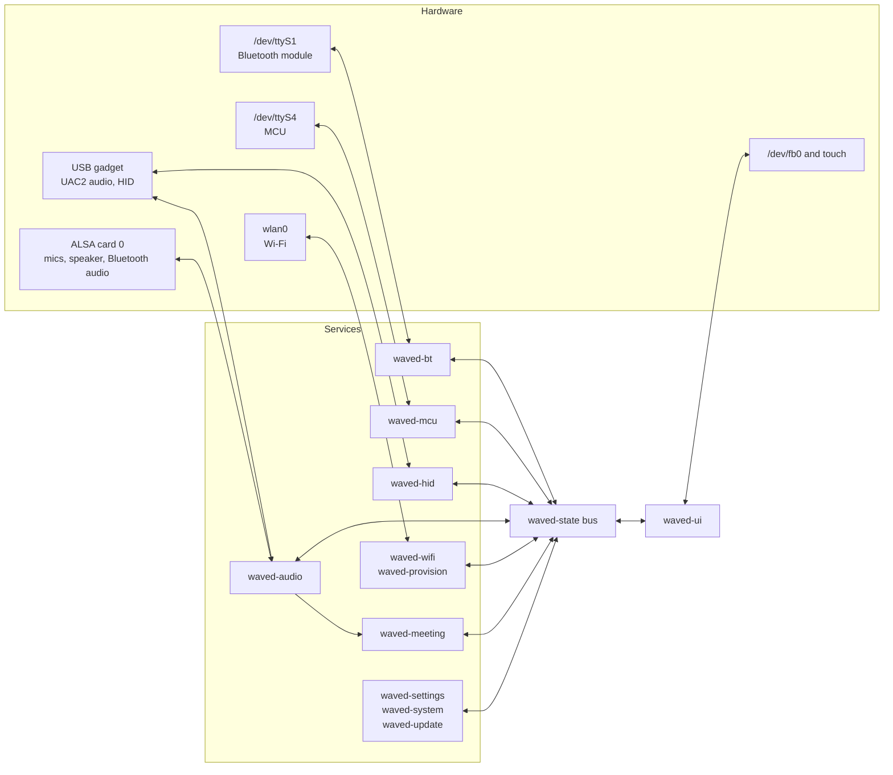

## One program

waved is one Rust program, `/data/waved/waved`, built from the workspace in
`waved/`. It runs its services on a tokio runtime, plus a few threads of its
own where hardware needs blocking reads and writes: the Bluetooth and MCU
serial links, audio capture, the USB audio bridges and the screen.

Two start-up scripts come with it, both from `waved/deploy/`. `S60waved` runs
it; `S03splash` draws the splash:

- `/etc/init.d/S60waved` starts waved at boot and restarts it about 3 seconds
  after any exit. Before each start it runs the update fall-back check (see
  [Updates](#updates) below). It also loads the firewall rules. The first
  waved after a boot is stopped after 5 seconds on purpose: its display output
  doesn't work, and the restarted one's does.
- `/etc/init.d/S03splash` writes the splash image to the screen about 2
  seconds after power-on, long before waved draws its own screens.

The Wave's read-only system partition is never written. waved replaces the
stock app through the overlay on `/data`: a stub `S60pspapp_daemon` keeps the
stock app from starting, and an empty `libapplogrs.so` stands in for the
stock telemetry library. The [Overview](/insta360-custom-firmware/start/overview/#what-changes-on-your-wave-and-what-doesnt)
lists every file.

## The state bus

`waved-state` defines the one `StateBus` that every service shares. It has
three kinds of channel:

- **State**, one watch channel per area, such as audio, battery, Bluetooth,
  Wi-Fi, Wi-Fi setup, recording, the MCU, settings, files, playback and
  updates. Each holds the latest value, so a reader always sees the current
  state.
- **Commands**, one broadcast channel: what the touch screen, the setup page,
  the computer and the Wave Controller app ask for, such as mute, a volume, an
  audio mode or "start recording". Each service subscribes and acts on the
  commands it owns.
- **Events**, one broadcast channel: things that happened, such as a power key
  press, low battery, a phone connecting or an upload that succeeded.

A service publishes its state and takes commands from the bus. The screen
never calls a service directly: it reads a snapshot of the state and sends
commands.

## Services

| Crate | Job |
|---|---|
| `waved` | The program: loads `config.toml`, builds the bus, starts every service, handles shutdown and power off. |
| `waved-state` | The bus, and the state, command and event types every other crate uses. |
| `waved-config` | `config.toml`: its format, loading with a fall-back to `config.toml.bak` and then defaults, migration from older versions, validation, the setup page's form fields, and the PIN hash. |
| `waved-settings` | Seeds the live settings from `config.toml` at boot and writes changes made on the Wave back to it. |
| `waved-audio` | Capture from the eight microphones, direction of arrival, beamforming, echo cancellation, gain, the speaker's processing, USB audio (UAC2) and Bluetooth audio. Writes `/tmp/audio_stats.json` every 500 ms. |
| `waved-meeting` | Recording: the WAV writer and the pre-recording buffer, the recordings list in SQLite, numbered speakers, webhook uploads with retries, pruning, and playback for Files. |
| `waved-ui` | The touch screen: LVGL, the screens, navigation, gestures and the PIN gate. |
| `waved-bt` | The Bluetooth module on `/dev/ttyS1`: pairing, disconnecting, calls and the connected phone. |
| `waved-uart` | The `/dev/ttyS1` serial port and its frame parser, which `waved-bt` runs on. |
| `waved-mcu` | The microcontroller on `/dev/ttyS4`: battery, the power key, the mic lift and power off. |
| `waved-mavlink` | MAVLink v2 framing, shared by the MCU link and the Wave Controller link. |
| `waved-hid` | The USB HID interface: volume and mute keys to the computer, call state from it, and the Wave Controller ("PC Link") protocol. |
| `waved-wifi` | Wi-Fi as a client through `wpa_supplicant`, saved networks, and setting the clock from time servers. |
| `waved-provision` | Wi-Fi setup: the temporary setup network, its DHCP and DNS, and the setup page. |
| `waved-system` | Screen dimming and backlight, time zone and real-time clock, About, recording tones, factory reset, and whether a computer is connected over USB. |
| `waved-update` | Signed updates from your own server, the trial boots, and `waved-pack`, the tool that packs and signs a release. |

`waved-audio` also links `waved-npu`, which holds the DeepFilterNet noise
reduction. Despite its name, that runs on the CPU: nothing in waved uses the
NPU today.

The other crates are tools and probes, not part of the installed program:
`waved-aec-probe`, `waved-latency-probe` and `waved-wakeup-probe` measure
echo cancellation and latency on a Wave; `waved-audio-bench` replays a
recorded capture through the audio service; `waved-capture-record` records
raw microphone audio; `waved-doa-tap` prints the direction-of-arrival stream;
`waved-mic-map` maps ALSA channels to physical microphones;
`waved-npu-probe` tests whether a process of ours can reach the NPU; and
`waved-device-test` is an older on-device check (see
[Testing](/insta360-custom-firmware/dev/testing/#on-a-wave)).

## The audio path

The microphones are eight MEMS mics read as one 8-channel ALSA device
(`hw:0,2`, 48 kHz). A capture thread hands each block of samples to the audio
service, which works in this order:

1. **Direction of arrival**, on the raw microphone signal. The time
   differences between mic pairs give the direction a voice comes from. It
   drives the talker arc on the screen, the Follow talker mode and the speaker
   numbers in recordings. When most of what the mics hear is the Wave's own
   speaker, the estimate skips that moment.
2. **Beamforming** combines the eight channels into the pickup pattern of the
   current [audio mode](/insta360-custom-firmware/features/#audio-modes).
3. **Echo cancellation** removes what the Wave's speaker played from the
   microphone signal: Speex's adaptive filter, then its linked residual-echo
   suppression.
4. **Voice clean-up:** late-reverb suppression and a voice equaliser, then a
   fixed make-up gain.
5. **Noise reduction** (DeepFilterNet, on the CPU) is off for now: it is too
   slow.
6. **Microphone gain** (the Mic level setting) and a limiter.

The result goes three ways: to the computer over USB (UAC2), to the
recording, and to the phone during a Bluetooth call (in mono).

The other direction: audio from the computer (USB), from a phone (Bluetooth)
and from the Wave itself (Files playback, tones) is mixed, goes through a
high-pass filter, an equaliser, a multiband level control and a limiter, then
the volume, and plays on the speaker (`hw:0,1`). That same signal, after the
volume, is the echo canceller's reference.

Details: [Audio hardware](/insta360-custom-firmware/reference/audio-hardware/#full-duplex-aec-pipeline).

## The screen

`waved-ui` runs LVGL 9.2 on its own thread. The panel is a round LCD driven by
`fb_ili79400`: a 400×304 framebuffer (`/dev/fb0`, 16-bit colour), of which a
circle of radius about 198 pixels shows. The panel is mounted upside down, so
waved rotates and byte-swaps every frame as it writes it. Touch comes from
`/dev/input/event1` and is flipped the same way.
[Display](/insta360-custom-firmware/reference/display-hardware/) has the
measurements.

Every screen has a snapshot test: it renders the screen on a computer, checks
that every button lies inside the visible circle, and compares the frame with
a PNG in `waved/crates/waved-ui/golden/`. The screenshots on this site are
those PNGs. [Testing](/insta360-custom-firmware/dev/testing/#ui-snapshot-tests)
shows how to run them.

## Recordings

The recording service gets the processed microphone signal, plus the far end
of a call, from the audio service. Each recording is a folder in
`/mnt/udisk/recordings` with `audio.wav` and `metadata.json`. The list of
recordings and each one's upload state live in a SQLite database,
`/data/waved/meetings.db`.

A recording is saved on the Wave before it is queued for upload. The queue is
in the database, so it survives a restart. Each upload is one HTTP `POST` to
your server, and retries reuse the recording's ID as the idempotency key.
[Recording webhooks](/insta360-custom-firmware/guides/webhooks/) has the
format.

## Updates

`waved-update` fetches `latest.json` from a server you run and downloads the
`.wup` package it names. The package is signed with ed25519; the Wave checks
the signature against the public key compiled into waved, then installs. A
package can only replace waved and its own files (the start-up scripts, the
splash, the firewall and logging configuration), never the system partition,
the kernel or the bootloader.

After an install the new version is on trial. `S60waved` counts boots: if the
new waved hasn't run for 60 seconds with working microphones by the third
boot, or restarts more than 10 times in one boot, it puts back the previous
files and `config.toml`. All of this is host-tested only.
[Updates](/insta360-custom-firmware/guides/updates/#install-and-fall-back-trial-boots)
has the details.
